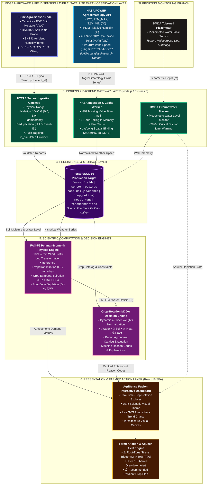
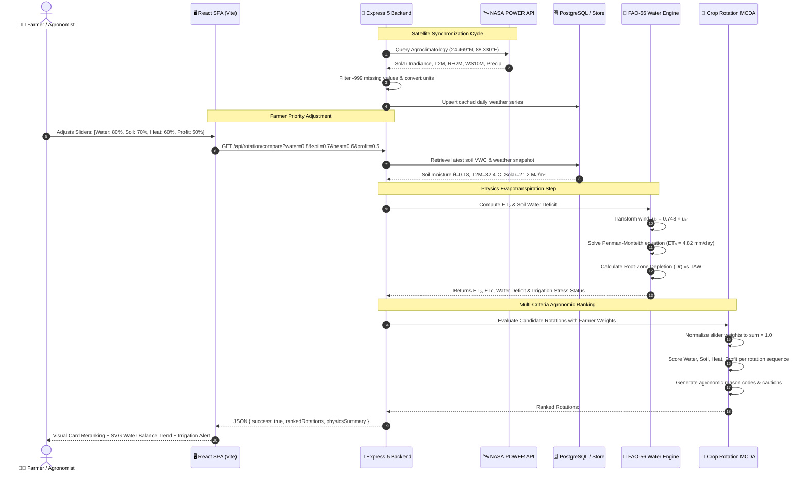
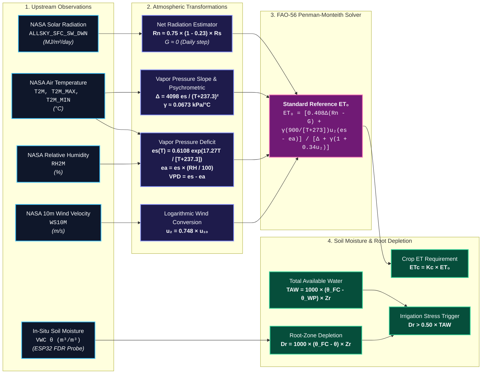
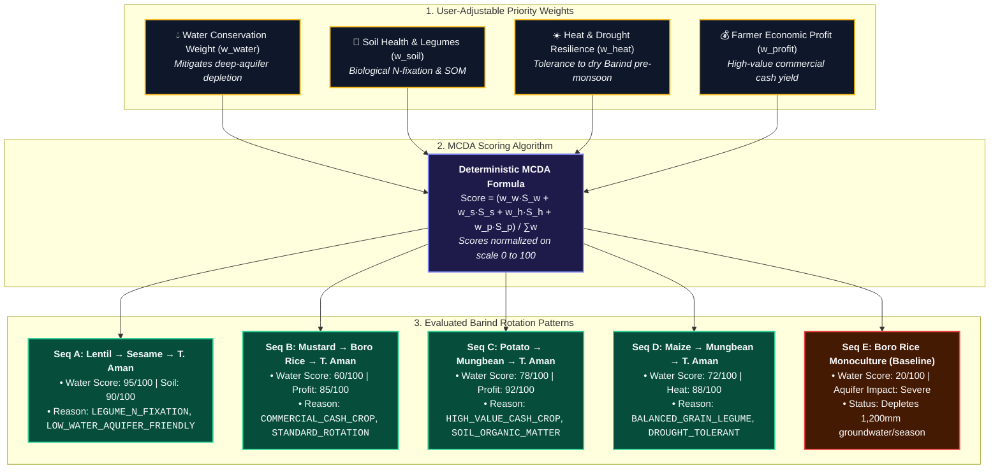
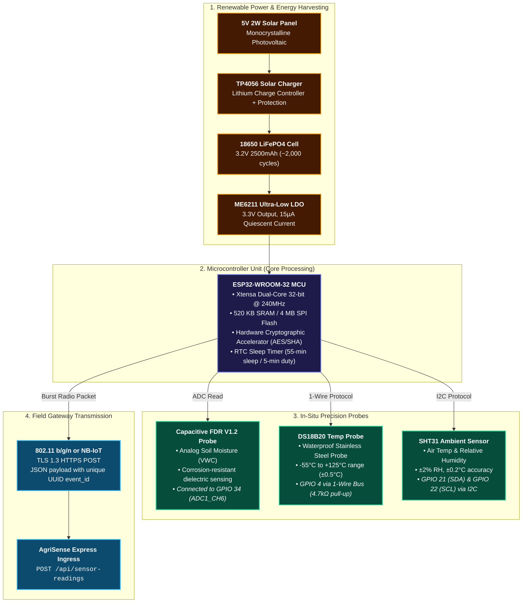
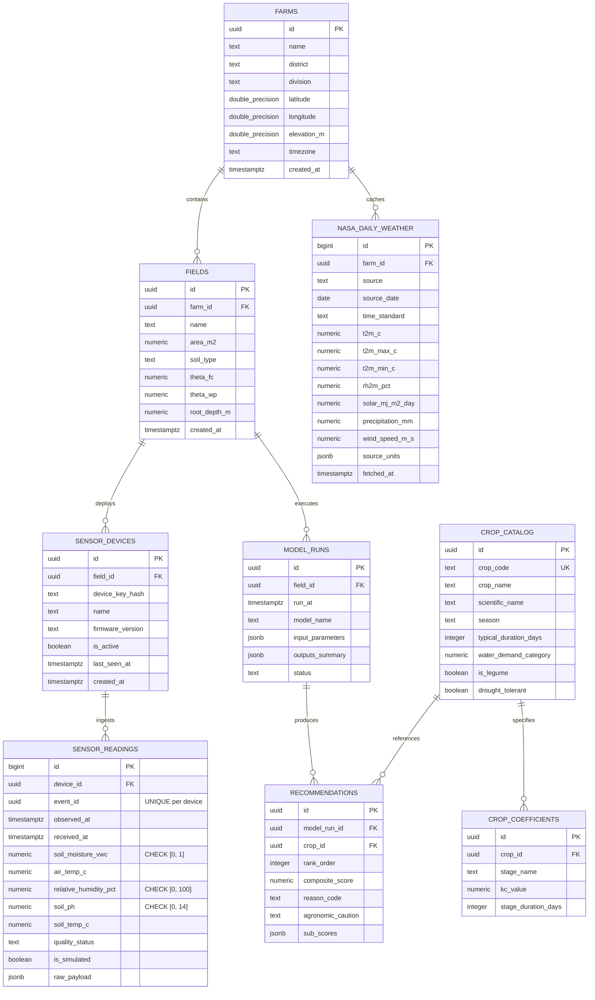
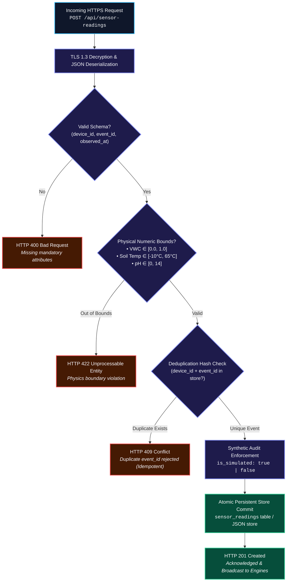

# AgriSense Fusion 🛰️🌾
### *NASA Space Apps Challenge 2026 — Challenge: Field Shift (Adapting Farms with NASA Data)*
**Target Region:** Northern Bangladesh (*Barind Tract: Rajshahi, Rangpur, Bogura, Chapai Nawabganj*)

[](https://www.spaceappschallenge.org/)
[](https://nodejs.org/)
[](https://expressjs.com/)
[](https://react.dev/)
[](https://vitejs.dev/)
[](https://www.postgresql.org/)
[](https://www.fao.org/land-water/databases-and-software/cropwat/en/)
[](LICENSE)

---

## 📖 Table of Contents
1. [Executive Summary & Problem Statement](#-executive-summary--problem-statement)
2. [High-Level System Architecture (Color-Coded Topology)](#-high-level-system-architecture)
3. [End-to-End Data Pipeline Flow](#-end-to-end-data-pipeline-flow)
4. [Scientific Physics & Mathematical Engine (FAO-56 Penman-Monteith)](#-scientific-physics--mathematical-engine)
5. [Crop-Rotation Multi-Criteria Decision Engine (MCDA)](#-crop-rotation-multi-criteria-decision-engine-mcda)
6. [Edge Hardware & IoT Sensor Circuit Architecture](#-edge-hardware--iot-sensor-circuit-architecture)
7. [Database Relational Architecture (ER Diagram)](#-database-relational-architecture)
8. [Security, Ingress & Idempotency Pipeline](#-security-ingress--idempotency-pipeline)
9. [Key Features & Capabilities](#-key-features--capabilities)
10. [Repository Structure](#-repository-structure)
11. [Quick Start & Local Deployment](#-quick-start--local-deployment)
12. [Verification & Automated Test Suite](#-verification--automated-test-suite)
13. [Scientific Transparency & Ethical Principles](#-scientific-transparency--ethical-principles)

---

## 🌍 Executive Summary & Problem Statement

In the drought-prone **Barind Tract of Northern Bangladesh**, agricultural survival faces a compounding crisis:
* Over **80% of boro dry-season rice** relies exclusively on deep-aquifer groundwater extraction.
* Regional tubewell water tables are dropping by up to **0.65 meters every year**, approaching the critical **28-meter suction lift limit** of conventional surface-mounted centrifugal irrigation pumps.
* Smallholder farmers lack hyper-local atmospheric evaporative demand metrics, causing either catastrophic crop water stress or severe over-irrigation.

**AgriSense Fusion** solves this systemic challenge by fusing **spaceborne NASA Earth Observations (NASA POWER)** with **in-situ ESP32 edge telemetry** and the rigorous, physics-grounded **FAO-56 Penman-Monteith reference evapotranspiration ($ET_0$) equation**. 

Its centerpiece is the **Crop-Rotation Explorer** — an explainable, deterministic Multi-Criteria Decision Analysis (MCDA) engine that allows farmers, agronomists, and policymakers to model climate-smart crop rotations (Mustard, Lentils, Mungbeans, Maize, Sesame, Potatoes) that reduce aquifer depletion while maximizing farmer livelihood and soil health.

---

## 🏛️ High-Level System Architecture

The AgriSense Fusion platform is engineered across **6 decoupled, resilient layers**. Satellite feeds, physical sensor streams, scientific modeling engines, and client interfaces communicate through strict typed schemas with comprehensive failover isolation:



### 🎨 Layer Color Mapping & Roles
| Color | Layer Name | Technology | Core Mission |
|:---:|:---|:---|:---|
| 🟣 **Indigo** (`#818cf8`) | **1. Edge Hardware** | ESP32, Capacitive FDR, DS18B20, SHT31 | High-precision in-situ soil & micro-climate sensing |
| 🔵 **Sky Blue** (`#38bdf8`) | **2. Earth Observation** | NASA POWER Daily Point API | Spaceborne solar irradiance, temperature, humidity, wind |
| 🟢 **Emerald** (`#34d399`) | **3. Ingress & Backend** | Node.js, Express 5, TLS 1.3 | Strict range validation, idempotency, missing-value filters |
| 🟪 **Purple** (`#c084fc`) | **4. Persistence** | PostgreSQL 16 DDL & Atomic JSON Store | Relational time-series and agronomic rule persistence |
| 🌸 **Rose** (`#f472b6`) | **5. Science & Decision** | FAO-56 Penman-Monteith, MCDA Engine | Deterministic water balance & 4-factor rotation ranking |
| 🟡 **Amber** (`#fbbf24`) | **6. Presentation** | React 18, Vite 5, SVG Charts | Dynamic sliders, explainable cards, farmer alerts |

---

## 🔄 End-to-End Data Pipeline Flow



---

## 🔬 Scientific Physics & Mathematical Engine

The core evaporative engine implements the international standard **FAO-56 Penman-Monteith equation** (Allen et al., 1998) to calculate daily Reference Evapotranspiration ($ET_0$) without empirical shortcuts:



### 📐 Mathematical Formulation Breakdown
1. **10m to 2m Logarithmic Wind Conversion:**
   $$u_2 = u_{10} \times \frac{4.87}{\ln(67.8 \times 10 - 5.42)} \approx 0.748 \times u_{10}$$
2. **Net Solar Radiation Calculation ($R_n$):**
   $$R_{ns} = (1 - \alpha) \times R_s \quad (\alpha = 0.23\text{ for green reference crop})$$
   $$R_n \approx 0.75 \times R_{ns} \quad (G \approx 0\text{ for 24-hour daily balance})$$
3. **Reference Evapotranspiration ($ET_0$):**
   $$ET_0 = \frac{0.408 \Delta (R_n - G) + \gamma \frac{900}{T + 273} u_2 (e_s - e_a)}{\Delta + \gamma (1 + 0.34 u_2)}$$
4. **Soil Water Balance & Root-Zone Depletion:**
   $$TAW = 1000 \times (\theta_{FC} - \theta_{WP}) \times Z_r \quad (\text{mm})$$
   $$D_r = 1000 \times (\theta_{FC} - \theta) \times Z_r \quad (\text{mm})$$
   $$\text{Irrigation Alert Triggered if } D_r > 0.50 \times TAW$$

---

## 🌾 Crop-Rotation Multi-Criteria Decision Engine (MCDA)



### 📊 Barind Crop Sequence Matrix
| Sequence | Crop Pattern | Water Demand | N-Fixation | Profit Potential | Best Used When |
|:---|:---|:---:|:---:|:---:|:---|
| **Lentil → Sesame → T. Aman** | Legume + Oilseed + Rainfed Rice | 🟢 Very Low (<400 mm) | 🟢 +35 kg N/ha | 🟡 Medium | Extreme water crisis; severe tubewell drawdown |
| **Mustard → Boro Rice → T. Aman** | Oilseed + Irrigated Rice + Rainfed Rice | 🟡 Moderate (~900 mm) | ⚪ Neutral | 🟢 High | Farmer transitioning off pure Boro monoculture |
| **Potato → Mungbean → T. Aman** | Tuber + Legume + Rainfed Rice | 🟢 Low-Mod (~550 mm) | 🟢 +25 kg N/ha | 🟢 Very High | Well-drained sandy loam; high capital available |
| **Maize → Mungbean → T. Aman** | Grain + Legume + Rainfed Rice | 🟡 Moderate (~600 mm) | 🟢 +20 kg N/ha | 🟢 High | High summer heat tolerance required |
| **Boro Rice Monoculture (Baseline)** | Flooded Rice Monoculture | 🔴 Extreme (>1,200 mm) | 🔴 Depleting | 🟡 Moderate | **Unsustainable**: Triggers critical aquifer alarm |

---

## ⚡ Edge Hardware & IoT Sensor Circuit Architecture



### 📡 Telemetry Packet Specification (HTTPS JSON)
```json
{
  "device_id": "esp32-barind-alpha-01",
  "event_id": "7c9e6679-7425-40de-944b-e07fc1f90ae7",
  "observed_at": "2026-10-10T12:00:00.000Z",
  "soil_moisture_vwc": 0.225,
  "air_temp_c": 31.4,
  "relative_humidity_pct": 58.2,
  "soil_ph": 6.8,
  "soil_temp_c": 26.5,
  "is_simulated": false
}
```

---

## 🗄️ Database Relational Architecture

The system features a **PostgreSQL 16 relational production schema** ([`database/schema.sql`](database/schema.sql)) with strict type constraints, foreign-key cascade hierarchies, check constraints, and B-Tree indexes:



---

## 🛡️ Security, Ingress & Idempotency Pipeline

Every edge packet undergoes strict multi-stage verification before database commit to prevent denial-of-service, duplicate counting, or corrupted model calculations:



---

## 🌟 Key Features & Capabilities

1. **Crop-Rotation Explorer (Explainable Decision Support)**
   - Real-time Multi-Criteria Decision Analysis with instant client-side weight rebalancing.
   - Transparent sub-score explanations: Water Conservation, Soil Health, Heat Resilience, Farmer Profit.
   - Machine reason codes (e.g., `LEGUME_BIOLOGICAL_N_FIXATION`, `LOW_WATER_AQUIFER_FRIENDLY`).

2. **Live NASA POWER Satellite Ingestion**
   - Direct integration with NASA Langley Research Center Agroclimatology point API.
   - Automated conversion from 10m to 2m wind speeds using standard logarithmic wind equations.
   - Missing-value filtering (`-999` strictly converted to `null`, never substituted with zero).

3. **FAO-56 Penman-Monteith Physics Water Engine**
   - Pure physical equations for reference evapotranspiration ($ET_0$) and crop water requirement ($ET_c$).
   - Calculates Total Available Water ($TAW$) and Root-Zone Depletion ($D_r$).
   - Automated irrigation stress warnings when soil moisture drops below 50% $TAW$.

4. **Interactive Architecture Canvas (`/architecture`)**
   - Live visual diagram in the web application displaying all 6 system layers.
   - Interactive Node Inspector: Click any component to inspect protocols, inputs, outputs, and verification status.

5. **Edge IoT Telemetry Ingress with Idempotency**
   - High-throughput REST API with physical range bounds checks and duplicate `event_id` rejection (HTTP 409).
   - Labelled simulation console allowing judges to test telemetry without physical hardware.

6. **Barind Groundwater Aquifer Monitor**
   - Monitors deep tubewell water tables against the critical 28m suction threshold.
   - Alerts users when unsustainable monoculture irrigation threatens regional water tables.

---

## 📁 Repository Structure

```
agrisense-fusion/
├── database/
│   └── schema.sql                  # PostgreSQL 16 production schema (DDL & Indexes)
├── docs/
│   ├── ARCHITECTURE.md             # In-depth architectural blueprint & specifications
│   ├── architecture.mmd            # Exportable, editable Mermaid architecture diagram
│   ├── DEMO_SCRIPT.md              # 3-minute hackathon judge walkthrough
│   └── IMPLEMENTATION_STATUS.md    # Component audit & verification report
├── frontend/                       # React 18 + Vite 5 single-page application
│   ├── src/
│   │   ├── components/             # Explorer, ArchitectureView, MetricCards, Charts, Modals
│   │   ├── App.jsx                 # Dashboard state, navigation, and API synchronization
│   │   └── index.css               # Scientific dark navy & emerald design tokens
│   ├── public/                     # Static media assets & video backgrounds
│   └── dist/                       # Compiled production bundle
├── server/                         # Node.js + Express 5 backend
│   ├── data/                       # Local persistent store (store.json)
│   ├── decision/                   # Deterministic MCDA Crop-Rotation Scoring Engine
│   ├── physics/                    # Standardized FAO-56 Penman-Monteith & Water Balance
│   ├── services/                   # NASA POWER fetcher & ESP32 telemetry ingestion
│   ├── tests/                      # Automated unit test suite (unit.test.js)
│   └── index.js                    # Core Express server & API routes
├── video/                          # Demonstration & challenge video assets
├── .env.example                    # Non-secret environment configuration
├── .gitignore                      # Clean ignore rules (node_modules, logs, secrets)
├── package.json                    # Scripts, metadata, and dependencies
├── test_endpoints.js               # End-to-end API verification script
└── README.md                       # Comprehensive documentation & architecture guide
```

---

## 🚀 Quick Start & Local Deployment

### Prerequisites
* **Node.js** (v18.0.0 or higher; tested on Node.js v20 & v26)
* **npm** (v9.0.0 or higher)

### 1. Installation
```bash
# Clone the repository
git clone https://github.com/ASHIK311/agrisense-fusion.git
cd agrisense-fusion

# Install backend dependencies
npm install

# (Optional) Build frontend from source if modifying React code
npm run build:frontend
```

### 2. Launch Application
```bash
npm start
```

Open your browser to:
* 🌾 **Main Dashboard & Crop-Rotation Explorer:** [`http://localhost:5000`](http://localhost:5000)
* 🏛️ **Interactive Architecture Canvas:** [`http://localhost:5000/architecture`](http://localhost:5000/architecture)
* 🩺 **Backend Health & Feature Endpoint:** [`http://localhost:5000/api/health`](http://localhost:5000/api/health)

---

## 🧪 Verification & Automated Test Suite

### 1. Run Unit Tests (FAO-56, Water Balance, Validation, MCDA)
```bash
npm test
```
*Executes 13 automated unit tests covering:*
* `saturationVapourPressure` calculation against thermodynamic tables
* FAO-56 Penman-Monteith reference $ET_0$ across realistic Barind Tract temperatures
* Missing weather input handling (graceful null fallbacks)
* Total Available Water ($TAW$) and Root-Zone Depletion ($D_r$)
* ESP32 sensor payload boundary checks ($0.0 \le \theta \le 1.0$)
* Duplicate event rejection (HTTP 409 idempotency)
* Dynamic MCDA weight rebalancing and reason code generation

### 2. Run End-to-End API Integration Verification
```bash
node test_endpoints.js
```
*Validates `/api/health`, `/api/farms`, `/api/weather/nasa`, `/api/water-balance`, `/api/rotation/compare`, and `/api/sensor-readings`.*

---

## 🔬 Scientific Transparency & Ethical Principles

* **No Synthetic Radar Claims:** We explicitly state what comes from NASA POWER (surface irradiance, 2m temperature, 10m wind, relative humidity) and do not fabricate hypothetical continuous SAR radar feeds.
* **Physics Over Guesswork:** We employ the internationally validated FAO-56 Penman-Monteith equation. Where parameters cannot be calibrated without physical lysimeters (such as direct soil evaporation $E_s$), we leave them as `null` rather than generating speculative figures.
* **Provisional Agronomic Guidance:** Crop rotation sequences reflect proven agronomic practices in Northern Bangladesh (Bangladesh Agricultural Research Institute - BARI guidelines) and are explicitly flagged as *provisional decision support* pending field validation by Department of Agricultural Extension (DAE) officers.

---

## 📜 License
This project is open-source and distributed under the **[MIT License](LICENSE)**.
Developed for the **NASA Space Apps Challenge 2026: Field Shift**.
