<p align="center">
  <a href="https://github.com/ASHIK311/agrisense-fusion">
    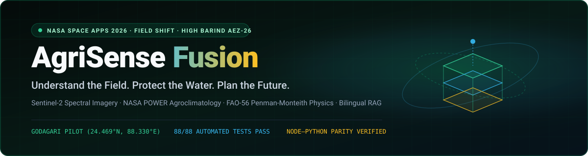
  </a>
</p>

<p align="center">
  <a href="https://www.spaceappschallenge.org/"></a>
  <a href="https://huggingface.co/datasets/ashik1236/nasatest"></a>
  <a href="https://github.com/ASHIK311/agrisense-fusion/actions/workflows/ci.yml"></a>
  <a href="documentation/TESTING.md"></a>
  <a href="documentation/SECURITY.md"></a>
  <a href="LICENSE"></a>
</p>

<p align="center">
  
  
  
  
  
  
</p>

<p align="center">
  <b>Can spaceborne NASA data save Northern Bangladesh's shrinking groundwater aquifers?</b><br/>
  AgriSense Fusion unifies Sentinel-2 spectral imagery, NASA POWER agroclimatology, simulated ESP32 soil telemetry,<br/>
  and deterministic FAO-56 Penman-Monteith physics into an explainable 3D Digital Twin for <b>Godagari, High Barind Tract (AEZ-26)</b>.
</p>

<p align="center">
  <a href="#-executive-summary--problem-statement"><b>Overview</b></a> ·
  <a href="#-visual-product-tour--verified-ui"><b>Visual Tour</b></a> ·
  <a href="#-10-minute-local-quickstart-windows-powershell"><b>Quickstart</b></a> ·
  <a href="#-testing--verification-summary"><b>Tests (88/88)</b></a> ·
  <a href="#-technical-architecture--system-engineering"><b>Architecture</b></a> ·
  <a href="#-complete-documentation-index"><b>Documentation</b></a> ·
  <a href="#-team-agrisense-fusion"><b>Team</b></a>
</p>

---

## 🌍 Executive Summary & Problem Statement

In the drought-stressed **High Barind Tract of Northern Bangladesh** (*Godagari Upazila, Rajshahi · `24.4690°N, 88.3300°E` · AEZ-26*), smallholder farming faces an acute hydrological crisis:

* Dry-season **Boro rice monoculture** demands intensive deep-tubewell irrigation across a semi-arid pre-monsoon window.
* Regional piezometric literature documents groundwater tables declining at **~0.65 m/year** (*Jahan et al., 2010*), pushing monitoring proxies (`26.4 m` / `27.8 m`) dangerously close to the **28.0 m critical suction limit** of surface-mounted centrifugal pumps.
* Generic agricultural chatbots hallucinate irrigation advice and crop numbers without hydrological grounding or provenance.

**AgriSense Fusion** transforms multi-agency Earth observations into **honest, physics-grounded crop decisions**:
1. **Satellite LULC Classification (`RandomForest_21Feat_Deep`):** Multi-temporal Sentinel-2 L2A scenes (`12` acquisitions, `2022–2025`, NDVI/NDWI/NDMI/EVI) classifying 4 broad land-cover classes with explicit scientific gates (`HTTP 422` against unvalidated species overclaims).
2. **FAO-56 Penman-Monteith Physics Engine:** Cross-language parity verified (`Node.js` ↔ `Python` across 4 seasonal Barind vectors) with canonical Silty Clay Loam root-zone defaults (`79.0 mm` TAW, `39.5 mm` RAW).
3. **Crop-Rotation MCDA Decision Explorer:** Dynamic 4-slider Multi-Criteria Decision Analysis (*Water Conservation, Soil Health, Heat Resilience, Farmer Profit*) comparing alternative sequences (e.g., *Lentil → Aus Rice → T. Aman*, *Mustard → Mungbean → T. Aman*) against conventional baselines.
4. **3D Stratigraphic & Dual-Canopy WebGL Digital Twin:** Interactive Three.js terrain strata synchronized pixel-for-pixel with Leaflet Sentinel-2 parcel polygons.
5. **Bilingual RAG Copilot (English & বাংলা):** Offline-capable hybrid BM25 + 3-gram RRF retrieval over `87` audited chunks (`100%` tool & disclosure pass) backed by `17` Bangladesh crop diseases and `60` DOI-verified papers.

---

## 📊 Verified Platform Metrics (In Numbers)

| Metric | Measured Value | Provenance / Verification |
|---|---|---|
| **Automated Test Suite** | **`88 / 88` passed (`0` failed)** | `npm test` across 7 suites (`~3.9s`) |
| **Live E2E Workflow Audit** | **`11 / 11` workflows + `3` gates** | `node server/tests/live_workflow_audit.js` |
| **LULC Classifier Holdout** | **`85.77%` Block C overall (`N=6,000`)** | `84.02%` bal. acc · `0.8257` Macro-F1 · `90.64%` interior |
| **Spatial 5-Fold CV** | **`84.63% ± 3.81%` (`N=20,000`)** | `RandomForest_21Feat_Deep` (`4` broad LULC classes) |
| **NASA POWER Daily Series** | **`1,827` rows (`2019–2024`) + Live API** | `-999` null guard + `Tmax >= 35°C` compound risk rule |
| **Node–Python Physics Parity** | **`4 / 4` Godagari seasonal profiles** | Exact `ET₀` parity (`7.49`, `2.41`, `2.94`, `3.80 mm/day`) |
| **Bilingual RAG Benchmark** | **`30/30` tool & disclosure (`81.82%` Hit@4)** | `87` curated chunks (`v2.1.2`), `12.99 ms` mean latency |
| **Pathology Literature Base** | **`17` diseases · `60` DOI papers** | `48` full-text, `5` abstract, `7` metadata confirmed |
| **Open Satellite Dataset** | **`~2.80 GB` GeoTIFFs & Climate CSV** | Hosted openly on Hugging Face ([`ashik1236/nasatest`](https://huggingface.co/datasets/ashik1236/nasatest)) |

---

## 📸 Visual Product Tour & Verified UI

Every screenshot below captures the compiled React + Vite + Three.js application executing against the live Node.js backend:

<p align="center">
  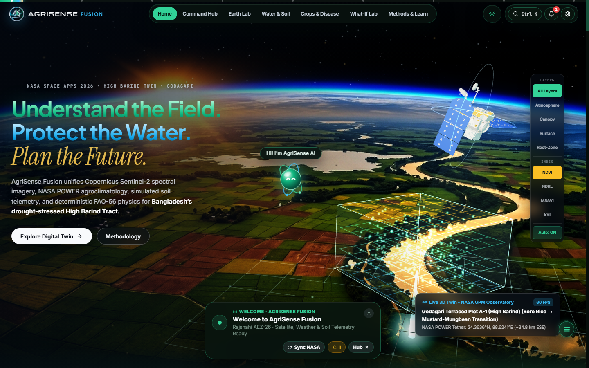
</p>

<table>
  <tr>
    <td width="50%">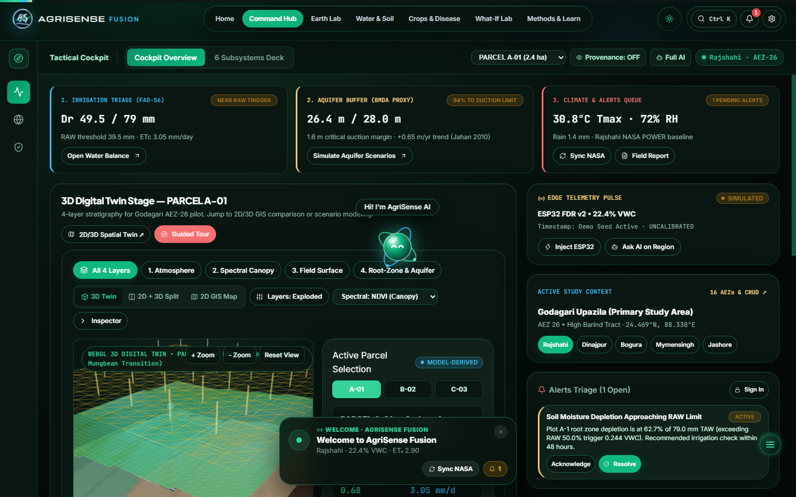<br/><sub><b>Tactical Command Hub.</b> Live FAO-56 depletion triage (<code>49.5 / 79 mm</code>), BMDA aquifer suction proxy (<code>26.4 / 28.0 m</code>), and explicit <code>SIMULATED</code> ESP32 badge.</sub></td>
    <td width="50%">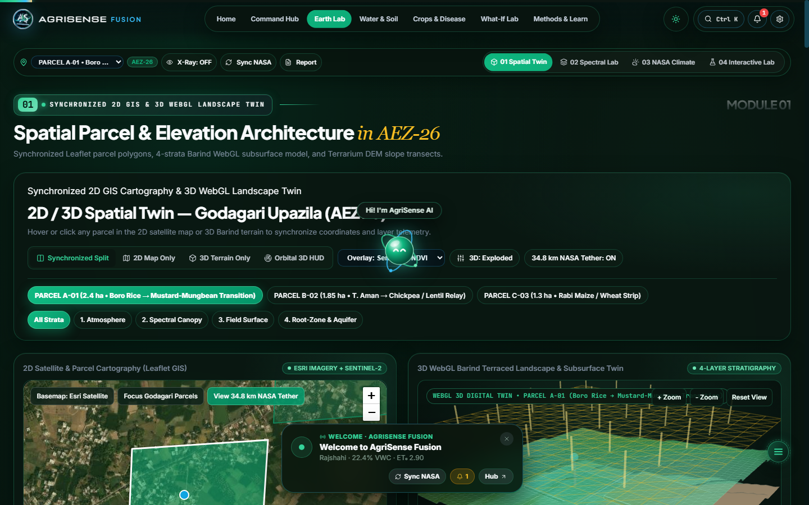<br/><sub><b>Synchronized 2D / 3D Earth Lab.</b> Esri/Sentinel-2 parcel cartography paired side-by-side with the 4-layer WebGL Barind stratigraphic twin.</sub></td>
  </tr>
  <tr>
    <td>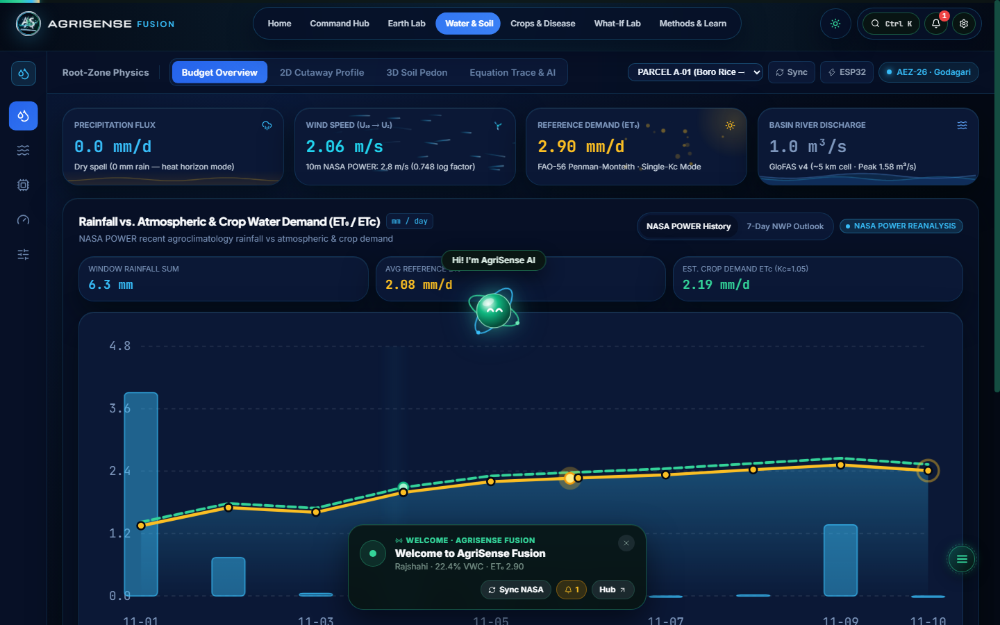<br/><sub><b>FAO-56 Water Budget & NASA POWER.</b> Daily rainfall vs. atmospheric <code>ET₀</code> and crop demand <code>ETc</code> trajectories for Godagari (<code>24.469°N, 88.330°E</code>).</sub></td>
    <td>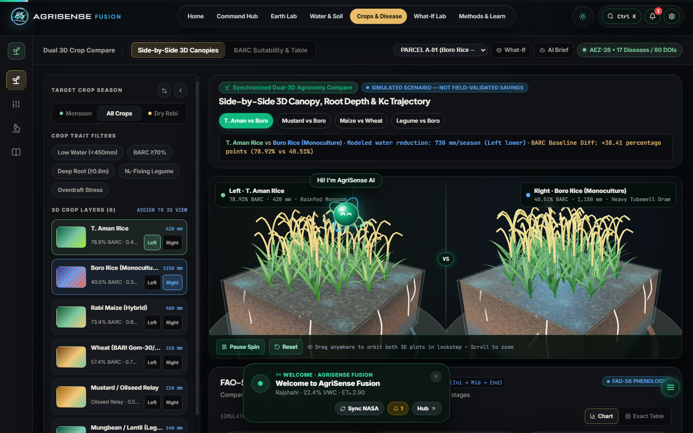<br/><sub><b>Dual-3D Crop Canopy Compare.</b> Lockstep WebGL comparison of root depth, seasonal water demand, and BARC suitability (e.g., <i>T. Aman</i> vs. <i>Boro Monoculture</i>).</sub></td>
  </tr>
  <tr>
    <td>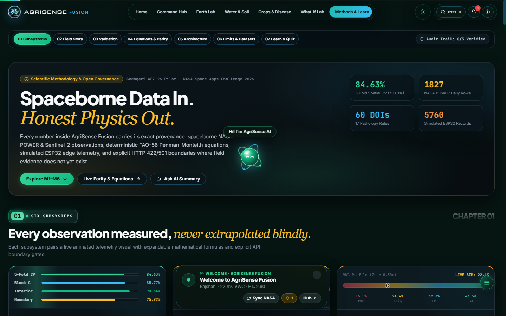<br/><sub><b>Scientific Provenance & Methods.</b> Open governance view surfacing spatial CV splits, soil thresholds, and explicit <code>HTTP 422 / 501</code> validation gates.</sub></td>
    <td>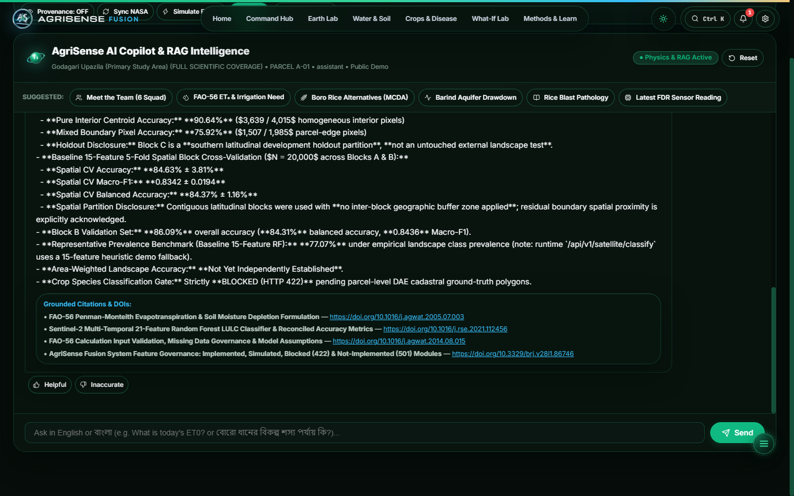<br/><sub><b>Bilingual AI Copilot (English &amp; বাংলা).</b> Deterministic tool execution paired with grounded DOI citations and honest model scope disclosures.</sub></td>
  </tr>
</table>

---

## ⚡ 10-Minute Local Quickstart (Windows PowerShell)

### Option A: 1-Click Windows Launcher
```powershell
git clone https://github.com/ASHIK311/agrisense-fusion.git
cd "agrisense-fusion"
.\start.bat
```
*Automatically installs dependencies if missing, launches the Express API (`:5000`) and Vite SPA (`:5173`), and opens `http://localhost:5173`.*

### Option B: Manual PowerShell Step-by-Step
```powershell
# 1. Install backend & frontend dependencies
npm.cmd install
npm.cmd --prefix frontend install

# 2. Configure local environment
Copy-Item .env.example .env

# 3. Run the 88-test verification suite
npm.cmd test

# 4. Start backend API (Terminal 1) and Vite frontend (Terminal 2)
node server/index.js
npm.cmd --prefix frontend run dev
```

<details>
<summary>
<h3>
  
  &nbsp;👉 <b>CLICK TO EXPAND: Cross-Platform Setup, Open Dataset Download & Troubleshooting</b>
</h3>
</summary>

### Linux / macOS Setup
```bash
git clone https://github.com/ASHIK311/agrisense-fusion.git
cd agrisense-fusion
npm ci
npm --prefix frontend ci
cp .env.example .env
npm test
npm --prefix frontend run build
node server/index.js &
npm --prefix frontend run dev
```

### Pull Heavy Satellite GeoTIFFs from Hugging Face (`~2.80 GB`)
```bash
pip install huggingface_hub
python scripts/download_dataset.py
# Or using HF CLI directly:
hf download ashik1236/nasatest --repo-type dataset --local-dir ./research/hf_datasets
```

### Troubleshooting
* **PowerShell Blocks `npm`:** Use `npm.cmd test` or run via Command Prompt (`cmd /c npm test`).
* **Port `5000` Already in Use:** Set `$env:PORT=5001; node server/index.js` or terminate orphaned Node processes before testing.
* **Preserving Clean Demo Store (`server/data/store.json`):** Point `AGRISENSE_STORE_FILE` to a temp path during ad-hoc write scripts (`npm test` isolates automatically).

</details>

---

## 🧪 Testing & Verification Summary

Every critical workflow, security boundary, and physics formula is verified across **7 top-level automated suites (`88 / 88` passed in `~3.9s`)**, an isolated live E2E harness, and an offline RAG evaluation benchmark:

| Test Suite / Harness | Command | Result | What It Verifies |
|---|---|:---:|---|
| **Core API Integration** | `server/tests/api_integration.test.js` | **20 / 20 PASS** | Health, auth, farms/fields, NASA POWER history, compound weather risk, ESP32 POST, satellite classify/meta, BARC suitability, FAO-56 water balance, 17 diseases, 60 DOIs, alerts, groundwater, reports, dashboard. |
| **RAG & AI Assistant** | `server/tests/assistant.test.js` | **13 / 13 PASS** | 9 deterministic tools, EN & বাংলা chat, disease disclaimer, 0.65 m/yr Jahan citation, uncalibrated ESP32 disclosure, SSE stream, `P0-01` metric guard, `P0-02` input guard, `P1-03` multi-tenant auth. |
| **Option 1 Patch Regression** | `server/tests/patch_regression.test.js` | **10 / 10 PASS** | Signup `'farmer'` role lock, security headers, `/favicon.ico != 500`, cross-tenant `404` isolation, canonical `79.0 mm` TAW / `39.5 mm` RAW parity, `RandomForest_21Feat_Deep`, `4000`-char limit + `429`, `1,827`-row Member 2 parity, soil provenance. |
| **Security & Multi-Tenant** | `server/tests/security_regression.test.js` | **12 / 12 PASS** | Production `JWT_SECRET >= 32` check, forged JWT `403`, auth barriers `401`, immutable demo farms `403`, rate limit `429`, honest `422` / `501` model gates, zero-denominator spectral protection. |
| **Physics, IoT & MCDA Units** | `server/tests/unit.test.js` | **13 / 13 PASS** | Penman-Monteith $ET_0$, $ET_c$, TAW, $D_r$ water balance, ESP32 physical bounds (`422`) & duplicate `event_id` (`409`), dynamic MCDA water vs. profit re-ranking. |
| **Persistence & Recovery** | `server/tests/persistence_safety.test.js` | **7 / 7 PASS** | Atomic writes, automatic `.bak` snapshot recovery, lock-safe rename without non-atomic corruption, clean seed recovery. |
| **ESP32 Hardware Auth** | `server/tests/device_auth.test.js` | **4 / 4 PASS** | Missing auth `401`, forged `x-device-key` rejection with valid `device_id`, timing-safe system key `201`, Bearer token `201`. |
| **Node–Python FAO-56 Parity** | `server/tests/fao56_parity.test.js` | **4 / 4 PASS** | Cross-language verification against Member 5 Python across 4 seasonal Godagari benchmarks (`7.49`, `2.41`, `2.94`, `3.80 mm/day`). |
| **Hydrology Terrain API** | `server/tests/hydrologyApi.test.js` | **2 / 2 PASS** | Terrarium RGB PNG elevation decoding and West➔East slope transect binning. |
| **Live E2E + RAG Harness** | `live_workflow_audit.js`, `run_rag_benchmark.js` | **11/11 + 30/30** | End-to-end live server workflows, 3 scientific gates (`422`/`501`), and `81.82%` RAG Hit@4 (`12.99 ms` mean). |

*(Full test case trace & reproduction steps: [`documentation/TESTING.md`](documentation/TESTING.md))*

---

## 🔒 Security Posture & Honest Engineering Disclosures

* **Zero Privilege Escalation (`P1-01` Closed):** Public registration (`POST /api/v1/auth/register`) strictly enforces `role: "farmer"`, discarding any client-supplied privilege escalation fields.
* **Timing-Safe Hardware Auth:** ESP32 edge telemetry enforces `crypto.timingSafeEqual` on `x-device-key` headers (`HTTP 401` on forged keys even when paired with registered `device_id`s).
* **Strict Tenant Isolation:** Cross-tenant farm, field, report, sensor export, and assistant conversation requests fail closed (`HTTP 404` / `401` / `403`).
* **Crash-Safe Atomic Storage:** `storageService.js` executes temp-file atomic replacement with exponential backoff and verified `.bak` snapshot recovery.

<details>
<summary>
<h3>
  
  &nbsp;👉 <b>CLICK TO EXPAND: Honest Engineering Disclosures & Scientific Scope Boundaries</b>
</h3>
</summary>

1. **Simulated Edge IoT Hardware:** Physical ESP32 sensors are pending field calibration. Baseline telemetry (`esp32-node-raj-01`, `5,760`-row offline dataset) carries `is_simulated: true` and `calibration_status: "UNCALIBRATED"`.
2. **Synthetic Groundwater Proxy:** Regional piezometer rows (`26.4 m` / `27.8 m` depths) serve `SYNTHETIC_REGIONAL_PROXY` data (`has_physical_piezometers: false`) anchored on Jahan et al. (2010) rather than live BMDA SCADA feeds.
3. **LULC Holdout vs. Species Gates:** `RandomForest_21Feat_Deep` (`85.77%` Block C holdout) was validated across contiguous latitudinal blocks for 4 broad LULC classes; fine crop-species classification (`HTTP 422`), multi-season yield prediction (`HTTP 501`), and NWP forecasting (`HTTP 501`) remain gated rather than fabricated.
4. **Provisional Soil & Rotation Modeling:** Barind Silty Clay Loam defaults (`79.0 mm` TAW, `39.5 mm` RAW) use Saxton & Rawls (2006) pedotransfer defaults, and crop-rotation comparisons represent modeled MCDA scenarios rather than multi-season field guarantees.
5. **PostgreSQL & Cloud LLMs:** `database/schema.sql` provides full PostgreSQL 16 + PostGIS DDL (`P2-02` deferred for local-first edge portability on `store.json`). Live Gemini/OpenAI modes remain `NOT_EVALUATED_NO_API_KEY_IN_ENV` in offline CI; offline deterministic synthesis runs cleanly with zero keys.

*(Full scientific disclosure matrix: [`documentation/KNOWN_LIMITATIONS.md`](documentation/KNOWN_LIMITATIONS.md))*

</details>

---

## 🏛️ Technical Architecture & System Engineering

### 1. High-Level 6-Layer System Architecture Topology

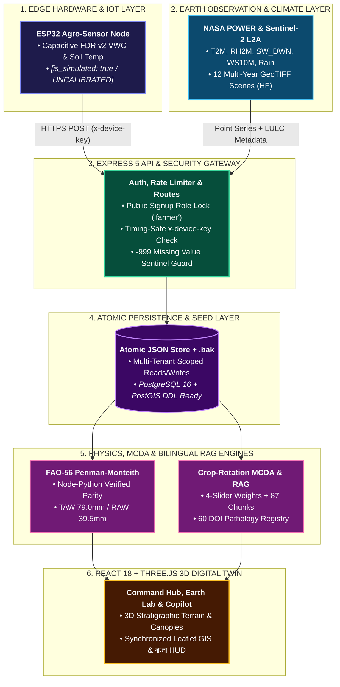

### 2. FAO-56 Penman-Monteith Physics & Soil Water Balance Flow

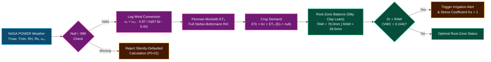

### 3. Crop-Rotation Multi-Criteria Decision Analysis (MCDA) Pipeline

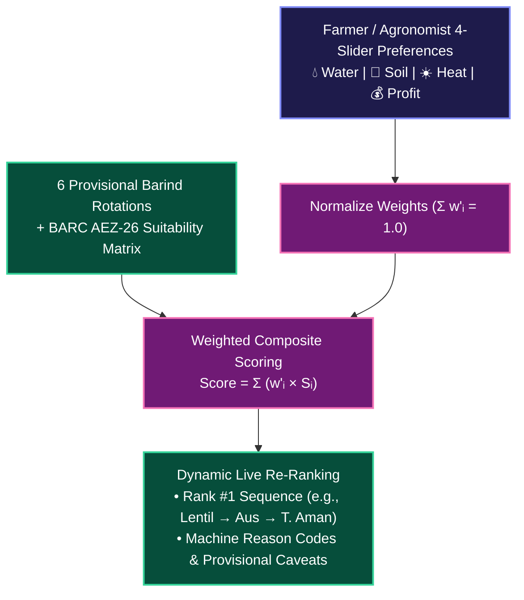

### 4. ESP32 Edge Telemetry Security & Idempotency Pipeline

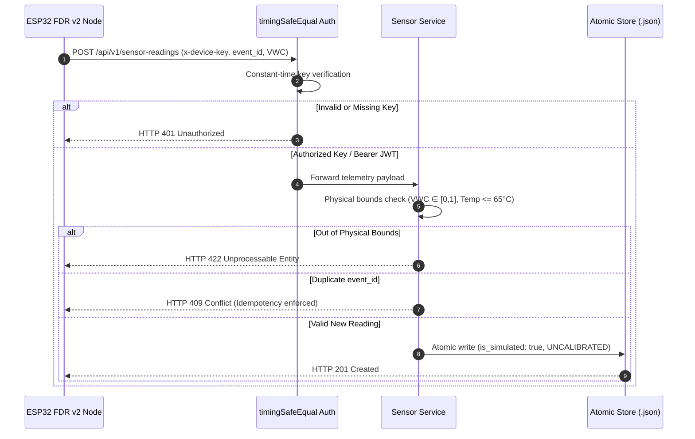

### 5. Bilingual Hybrid RAG Decision & Scientific Guardrail Pipeline

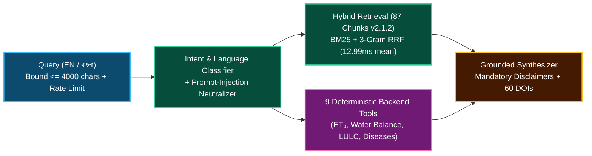

---

## 📂 Repository Directory Architecture

```text
agrisense-fusion/                                  # Clean GitHub repository root (~39 MB)
├── README.md                                      # Executive overview, visual tour, quickstart & architecture
├── LICENSE                                        # MIT Open Source License
├── .gitattributes                                 # Linguist language classification & cross-OS EOL normalization
├── .gitignore                                     # Excludes node_modules, .venv, .env*, .bak & heavy GeoTIFFs
├── .env.example                                   # Environment variable template (JWT, NASA, optional LLM keys)
├── .github/workflows/ci.yml                       # Automated CI: 88 Node tests, RAG benchmark, Python & Vite build
├── start.bat                                      # 1-Click Windows launcher (Express :5000 + Vite :5173)
├── package.json                                   # Backend dependencies (Express 5, bcryptjs, jwt, pg) & test runner
├── audit_phase0.py                                # Forensic cross-member verification generator
├── generate_fao56_benchmark.py                    # Cross-language Node-Python FAO-56 benchmark generator
├── test_endpoints.js                              # Rapid endpoint health & contract smoke script
│
├── database/
│   └── schema.sql                                 # PostgreSQL 16 + PostGIS DDL (aligned Barind soil defaults)
│
├── documentation/                                 # Complete engineering, audit, review & submission documentation
│   ├── ENGINEERING.md                             # Improvement matrix, benchmarks, parity & repo hygiene report
│   ├── ARCHITECTURE.md                            # System topology & multiscale fusion architecture
│   ├── HANDOFF.md                                 # Developer onboarding, operational rules & gotchas
│   ├── PROJECT_PLAN.md                            # Field Shift alignment, metrics & post-hackathon roadmap
│   ├── SUBMISSION.md                              # Space Apps submission text, 5-min pitch & 10-step demo script
│   ├── TESTING.md                                 # Canonical breakdown of all 88 tests & E2E harnesses
│   ├── SECURITY.md                                # Auth hardening, timing-safe keys, multi-tenant isolation
│   ├── API_REFERENCE.md                           # Exhaustive REST API specification + 422/501 gates
│   ├── KNOWN_LIMITATIONS.md                       # Honest engineering disclosures & scientific boundaries
│   ├── SRS.md                                     # Full Software Requirements Specification
│   ├── readme/                                    # Custom SVG banner + 7 high-res verified UI screenshots
│   ├── review/                                    # External BARC/BMDA expert review kit & CSV scorecard
│   └── ui-ux/                                     # Interface design notes & accessibility guidelines
│
├── frontend/                                      # React 18 + Vite 5 + Three.js + Leaflet SPA
│   ├── public/team/                               # Official 6-member squad portraits
│   ├── public/models/                             # 3D GPM satellite GLB model & Draco decoders
│   └── src/                                       # Workspaces: Command Hub, Earth Lab, Water, Crops, What-If, Methods
│
├── server/                                        # Express 5 Backend & Scientific Engines
│   ├── index.js                                   # Security headers, CORS allowlist, v1 route mounting
│   ├── adapters/ingest_all.py                     # Harmonizes research/member_01..06 into master seed JSON
│   ├── assistant/                                 # Bilingual RAG service, 9 deterministic tools & system prompts
│   ├── data/                                      # master_database_seed.json, rag_knowledge_base.json, clean store.json
│   ├── decision/                                  # Crop-Rotation MCDA engine & Barind crop catalog
│   ├── middleware/                                # JWT auth, timing-safe device key, rate limiter, error handler
│   ├── physics/                                   # FAO-56 Penman-Monteith ET₀ & root-zone water balance
│   ├── routes/                                    # 13 modular API v1 route controllers
│   ├── services/                                  # Auth, NASA POWER fetcher, hydrology PNG decoder, sensor service
│   ├── storage/                                   # Crash-safe atomic JSON + .bak engine & Postgres pool
│   └── tests/                                     # 88 automated Node tests + live workflow + RAG benchmarks
│
├── research/                                      # Consolidated 6-Member Scientific Modules & Forensic Audits
│   ├── README.md                                  # Guide across Member 01–06 deliverables
│   ├── dataset_card.md                            # Hugging Face open dataset metadata card (ashik1236/nasatest)
│   ├── member_01_satellite_gis/                   # Sentinel-2 preprocessing scripts, schemas, spatial holdout audits
│   ├── member_02_weather_risk/                    # 1,827-day NASA POWER Godagari risk model & charts
│   ├── member_03_iot_hardware/                    # ESP32 C++ firmware, schematics, BOM, 5,760-row calibration audits
│   ├── member_04_agronomy_mcda/                   # BARC AEZ-26 crop suitability, calendars & rotation datasets
│   ├── member_05_hydrology_physics/               # Python FAO-56 water balance reference implementation
│   └── member_06_crop_pathology/                  # 17 Bangladesh crop diseases & 60 DOI-verified papers
│
└── scripts/
    └── download_dataset.py                        # Pulls ~2.80 GB GeoTIFF rasters from Hugging Face (ashik1236/nasatest)
```

---

## 📚 Complete Documentation Index

| Documentation Book | Purpose & Contents |
| :--- | :--- |
| 🛠️ [`documentation/ENGINEERING.md`](documentation/ENGINEERING.md) | 25-item Improvement Matrix (`P0–P3`), performance benchmarks, parity & repo audit |
| 🏗️ [`documentation/ARCHITECTURE.md`](documentation/ARCHITECTURE.md) | Multi-layer system topology, data pipelines, and storage architecture |
| 🤝 [`documentation/HANDOFF.md`](documentation/HANDOFF.md) | Developer onboarding guide, operational rules, and clean-store isolation tips |
| 🗺️ [`documentation/PROJECT_PLAN.md`](documentation/PROJECT_PLAN.md) | Challenge requirements, quantitative baselines, and post-hackathon roadmap |
| 🏆 [`documentation/SUBMISSION.md`](documentation/SUBMISSION.md) | Ready-to-paste Space Apps submission text, 5-min speaker pitch, 10-step demo |
| 🧪 [`documentation/TESTING.md`](documentation/TESTING.md) | Canonical breakdown of all `88` Node tests, E2E audits & RAG benchmarks |
| 🛡️ [`documentation/SECURITY.md`](documentation/SECURITY.md) | Role locks, `timingSafeEqual` ESP32 auth, tenant isolation, and headers |
| 🔌 [`documentation/API_REFERENCE.md`](documentation/API_REFERENCE.md) | Exhaustive REST API catalog across all routes plus `HTTP 422 / 501` gates |
| ⚠️ [`documentation/KNOWN_LIMITATIONS.md`](documentation/KNOWN_LIMITATIONS.md) | Honest disclosures of simulated IoT, groundwater proxies & model boundaries |
| 🌾 [`documentation/review/EXPERT_REVIEW_KIT.md`](documentation/review/EXPERT_REVIEW_KIT.md) | External BARC / BMDA agronomic validation rubric and [`review_sheet.csv`](documentation/review/review_sheet.csv) |
| 🛰️ [`research/dataset_card.md`](research/dataset_card.md) | Hugging Face open dataset specification for [`ashik1236/nasatest`](https://huggingface.co/datasets/ashik1236/nasatest) |
| 📜 [`documentation/SRS.md`](documentation/SRS.md) | Complete Software Requirements Specification & cross-subsystem traceability |

---

## 👩‍🚀 Team AgriSense Fusion

<table>
  <tr>
    <td align="center" width="16.6%"><br/><b>Nakib Md Ashik</b><br/><sub>Team Lead &amp; System Architect</sub></td>
    <td align="center" width="16.6%"><br/><b>Shah Ismat Mahmud Tanim</b><br/><sub>Research &amp; Pathology Ops</sub></td>
    <td align="center" width="16.6%"><br/><b>Md. Riazul Islam Tusar</b><br/><sub>Backend &amp; API Integration</sub></td>
    <td align="center" width="16.6%"><br/><b>Mynuddin Ahmed</b><br/><sub>Frontend &amp; 3D Spatial UX</sub></td>
    <td align="center" width="16.6%"><br/><b>Tanvir Kabir</b><br/><sub>IoT &amp; ESP32 Hardware</sub></td>
    <td align="center" width="16.6%"><br/><b>Md Mizanur Rahman</b><br/><sub>Vadose Hydrology &amp; Physics</sub></td>
  </tr>
</table>

<p align="center"><sub>Engineered in Dhaka, Bangladesh 🇧🇩 for the 2026 NASA International Space Apps Challenge (*Field Shift* Track).</sub></p>

---

## 📜 Scientific Attribution & License

* **Earth Observation & Weather Data:** NASA POWER Project (Langley Research Center), Copernicus Sentinel-2 L2A (ESA), ESA WorldCover 10m, ISRIC SoilGrids.
* **Agronomic & Hydrological Standards:** FAO Irrigation & Drainage Paper No. 56 (Allen et al., 1998), Saxton & Rawls (2006) Soil Water Characteristics, Bangladesh Agricultural Research Council (BARC AEZ-26), Jahan et al. (2010) Barind Aquifer Drawdown Studies.
* **Disclaimer:** NASA does not endorse this project. Regional groundwater monitoring records and ESP32 sensor feeds operate as explicitly labeled simulation/proxy baselines until physical field deployment and gravimetric calibration occur.

Released under the **[MIT License](LICENSE)**.
