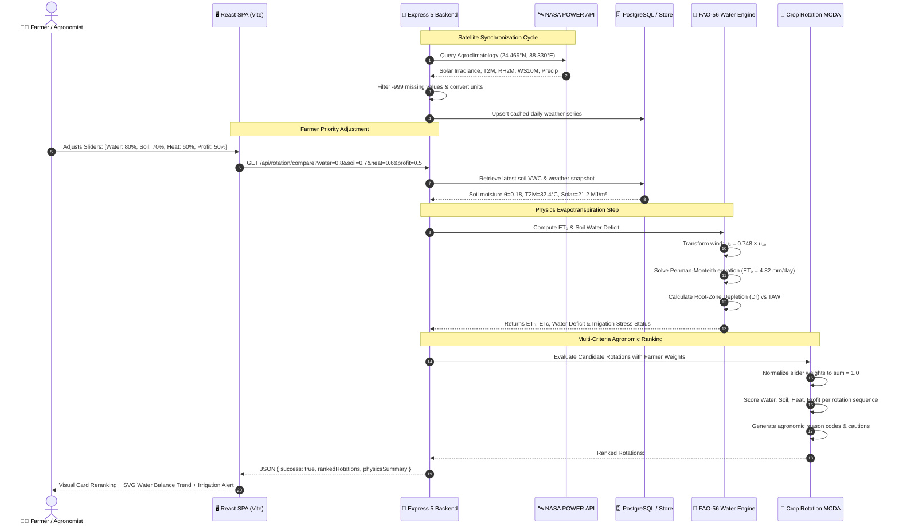
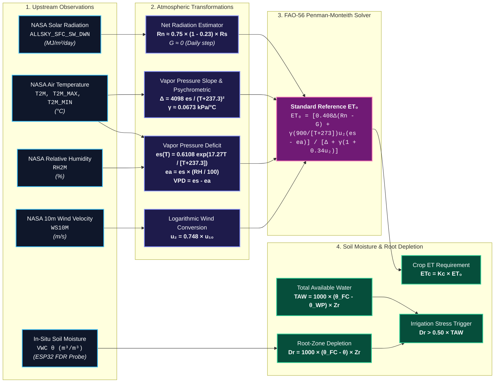
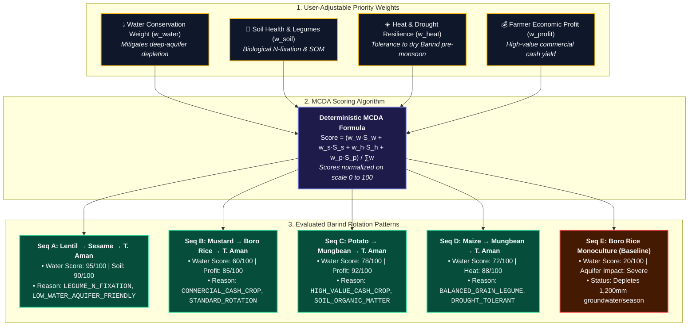
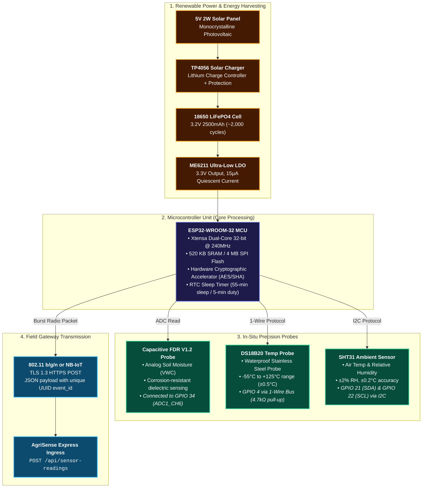
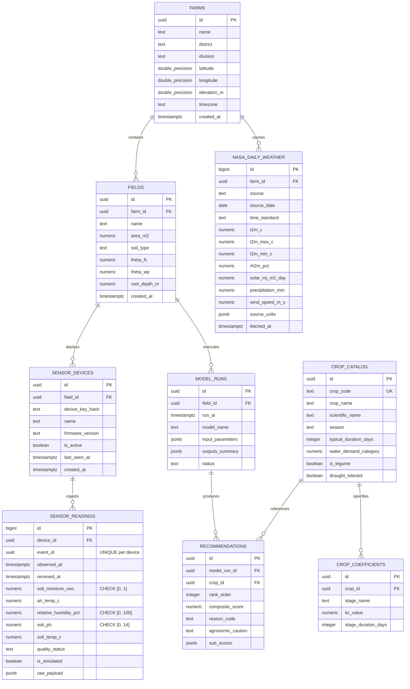
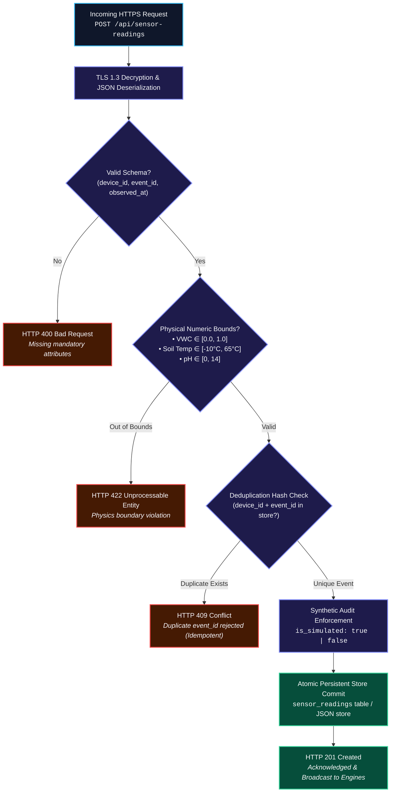

# AgriSense Fusion — System Architecture & Data Flow Specification
### *NASA Space Apps Challenge 2026: Field Shift (Adapting Farms with NASA Data)*
**Document Version:** 2.0 (Production Blueprint Aligned & Color-Coded Architecture Edition)  
**Target Region:** Northern Bangladesh (*Barind Tract: Rajshahi, Rangpur, Bogura, Chapai Nawabganj*)

---

## 1. System Overview & Architectural Tenets

AgriSense Fusion is structured around a strict separation of concerns across **six decoupled, fault-tolerant layers**. The core architectural mandate states that **in-situ sensor observations, upstream satellite weather data, physics model outputs, and agronomic rotation decisions must be stored, validated, and processed independently**. 

This foundational principle ensures:
1. **Cascade Isolation:** Failure or latency in upstream satellite APIs cannot degrade edge sensor ingress or offline local decision models.
2. **Reproducible Scientific Audits:** Upstream raw observations are immutably archived before entering physical transformations, allowing researchers to rerun and audit calculations.
3. **Idempotency & Data Hygiene:** Edge telemetry streams enforce UUID deduplication and physics-based boundary checks before database commit.
4. **Explainable AI/MCDA:** Farmer recommendations always expose sub-score weights, machine reason codes, and provisional agronomic cautions.

```mermaid
graph TB
  %% Class Definitions with Distinct Colors
  classDef edgeLayer fill:#1e1b4b,stroke:#818cf8,stroke-width:2px,color:#f8fafc;
  classDef satLayer fill:#0c4a6e,stroke:#38bdf8,stroke-width:2px,color:#f8fafc;
  classDef ingressLayer fill:#064e3b,stroke:#34d399,stroke-width:2px,color:#f8fafc;
  classDef storeLayer fill:#3b0764,stroke:#c084fc,stroke-width:2px,color:#f8fafc;
  classDef scienceLayer fill:#701a75,stroke:#f472b6,stroke-width:2px,color:#f8fafc;
  classDef uiLayer fill:#451a03,stroke:#fbbf24,stroke-width:2px,color:#f8fafc;
  classDef supportLayer fill:#1c1917,stroke:#a8a29e,stroke-width:2px,stroke-dasharray: 4 4,color:#f8fafc;

  subgraph Layer1["1. EDGE HARDWARE & SENSING LAYER"]
    ESP32["<b>ESP32 Agro-Sensor Node</b><br/>• Capacitive FDR Soil Moisture (VWC)<br/>• DS18B20 Soil Temp Probe<br/>• SHT31 Ambient Humidity/Temp<br/><i>[TLS 1.3 / HTTPS REST Client]</i>"]:::edgeLayer
  end

  subgraph Layer2["2. SATELLITE EARTH OBSERVATION LAYER"]
    NASA["<b>NASA POWER Agroclimatology API</b><br/>• T2M, T2M_MAX, T2M_MIN (°C)<br/>• RH2M Relative Humidity (%)<br/>• ALLSKY_SFC_SW_DWN Solar (MJ/m²/day)<br/>• WS10M Wind Speed (m/s) & PRECTOTCORR<br/><i>[NASA Langley Research Center]</i>"]:::satLayer
  end

  subgraph Layer3["3. INGRESS & BACKEND GATEWAY LAYER (Node.js / Express 5)"]
    IngressAPI["<b>HTTPS Sensor Ingestion Gateway</b><br/>• Physical Range Validation: VWC ∈ [0.0, 1.0]<br/>• Idempotency Deduplication (UUID Event-ID)<br/>• Audit Tagging: is_simulated Enforcer"]:::ingressLayer
    NASAWorker["<b>NASA Ingestion & Cache Worker</b><br/>• -999 Missing Value Filter → null<br/>• 1-Hour Rolling In-Memory & File Cache<br/>• Lat/Long Spatial Binding (24.469°N, 88.330°E)"]:::ingressLayer
    GWWorker["<b>BMDA Groundwater Tracker</b><br/>• Piezometric Water Level Monitor<br/>• 28.0m Critical Suction Limit Warning"]:::ingressLayer
  end

  subgraph Layer4["4. PERSISTENCE & STORAGE LAYER"]
    DB[("<b>PostgreSQL 16 Production Target</b><br/><code>farms</code> | <code>fields</code> | <code>sensor_readings</code><br/><code>nasa_daily_weather</code> | <code>crop_catalog</code><br/><code>model_runs</code> | <code>recommendations</code><br/><i>(Atomic File Store Fallback Active)</i>")]:::storeLayer
  end

  subgraph Layer5["5. SCIENTIFIC COMPUTATION & DECISION ENGINES"]
    FAO56["<b>FAO-56 Penman-Monteith Physics Engine</b><br/>• 10m → 2m Wind Profile Log Transformation<br/>• Reference Evapotranspiration (ET₀ mm/day)<br/>• Crop Evapotranspiration (ETc = Kc × ET₀)<br/>• Root-Zone Depletion (Dr) vs TAW"]:::scienceLayer
    MCDA["<b>Crop-Rotation MCDA Decision Engine</b><br/>• Dynamic 4-Slider Weights Normalization<br/>• 💧 Water • 🌱 Soil • ☀️ Heat • 💰 Profit<br/>• Barind Agronomic Catalog Evaluation<br/>• Machine Reason Codes & Explanations"]:::scienceLayer
  end

  subgraph Layer6["6. PRESENTATION & FARMER ACTION LAYER (React 18 SPA)"]
    Dashboard["<b>AgriSense Fusion Interactive Dashboard</b><br/>• Real-Time Crop Rotation Explorer<br/>• Dark Scientific Visual Theme<br/>• Live SVG Atmospheric Trend Charts<br/>• /architecture Visual Canvas"]:::uiLayer
    AlertSystem["<b>Farmer Action & Aquifer Alert Engine</b><br/>• ⚠️ Root-Zone Stress Trigger (Dr > 50% TAW)<br/>• 🚨 Deep Tubewell Drawdown Alert<br/>• 📋 Recommended Resilient Crop Plan"]:::uiLayer
  end

  subgraph LayerSupport["SUPPORTING MONITORING BRANCH"]
    BMDA["<b>BMDA Tubewell Piezometer</b><br/>• Piezometric Water Table Sensor<br/><i>[Barind Multipurpose Dev. Authority]</i>"]:::supportLayer
  end

  ESP32 -- "HTTPS POST (VWC, Temp, pH, event_id)" --> IngressAPI
  NASA -- "HTTPS GET (Agroclimatology Point Series)" --> NASAWorker
  BMDA -. "Piezometric Depth (m)" .-> GWWorker

  IngressAPI -- "Validated Records" --> DB
  NASAWorker -- "Normalized Weather Upsert" --> DB
  GWWorker -. "Well Telemetry" .-> DB

  DB -- "Soil Moisture & Water Level" --> FAO56
  DB -- "Historical Weather Series" --> FAO56
  DB -- "Crop Catalog & Constraints" --> MCDA

  FAO56 -- "ET₀, ETc, Water Deficit (Dr)" --> MCDA
  FAO56 -- "Atmospheric Demand Metrics" --> Dashboard

  MCDA -- "Ranked Rotations & Reason Codes" --> Dashboard
  GWWorker -. "Aquifer Depletion State" .-> Dashboard

  Dashboard --> AlertSystem
```



---

## 2. Layer Responsibilities & Technical Contracts

### Layer 1: Edge Sensing & Field Hardware
* **Microcontroller:** ESP32-WROOM-32 (Xtensa 32-bit dual-core, 240MHz, 520KB SRAM).
* **Sensors:**
  * Capacitive FDR (Frequency-Domain Reflectometry) Soil Moisture Probe v1.2 (analog output to ADC1_CH6, GPIO 34).
  * Waterproof DS18B20 digital temperature probe (Dallas 1-Wire protocol on GPIO 4 with 4.7kΩ pull-up).
  * Sensirion SHT31 precision ambient temperature and humidity sensor (I2C on GPIO 21 SDA / GPIO 22 SCL).
* **Power Management:** 18650 3.2V LiFePO4 battery (2,500mAh) paired with a 5V 2W monocrystalline solar panel and TP4056 lithium charge controller. 55-minute deep sleep / 5-minute active burst cycle ($I_{\text{sleep}} \approx 15\,\mu\text{A}$).
* **Groundwater Branch:** Tracks BMDA deep tubewell water tables against the 28.0m centrifugal suction limit.

### Layer 2: Satellite Earth Observation (NASA POWER)
* **Source Endpoint:** `https://power.larc.nasa.gov/api/temporal/daily/point` (Agroclimatology Community).
* **Geographical Bounding Box:** Centered on Northern Bangladesh (Rajshahi / Barind: Lat `24.469°N`, Long `88.330°E`).
* **Ingested Parameters:**
  * `T2M` / `T2M_MAX` / `T2M_MIN`: Air temperature at 2m (°C).
  * `RH2M`: Relative humidity at 2m (%).
  * `ALLSKY_SFC_SW_DWN`: All-sky shortwave solar irradiance ($\text{MJ/m}^2/\text{day}$).
  * `WS10M`: Wind speed at 10m height ($\text{m/s}$).
  * `PRECTOTCORR`: Corrected daily precipitation ($\text{mm/day}$).
* **Normalization Engine:** Automatically maps NASA missing flag `-999` to `null` to prevent numeric calculation corruption.

### Layer 3: Ingress & Backend Gateway (Node.js / Express 5)
* **API Ingress Gateway (`server/services/sensorService.js`):**
  * Strict schema validation: Enforces required `device_id`, `event_id`, and `observed_at`.
  * Physics bounds checking: Volumetric Water Content (VWC) $\in [0.0, 1.0]$, temperature $\in [-10^\circ\text{C}, 65^\circ\text{C}]$, pH $\in [0, 14]$. Out-of-bounds requests are rejected with `HTTP 422 Unprocessable Entity`.
  * Idempotency protection: Rejects duplicate UUIDs with `HTTP 409 Conflict`.
  * Audit enforcement: Enforces `is_simulated: true` on all synthetic testing payloads.
* **NASA Worker Service (`server/services/nasaService.js`):**
  * Implements 1-hour rolling cache with file persistence to adhere to public API rate limits.
  * Fallback mechanism: Reverts to cached observations with `source_status: 'partial'` if the remote API experiences timeout (>10s).

### Layer 4: Storage & Persistence Layer
* **Production PostgreSQL Target (`database/schema.sql`):** Relational schema with UUID primary keys, check constraints, cascade deletes, and B-Tree indexes for `farms`, `fields`, `sensor_devices`, `sensor_readings`, `nasa_daily_weather`, `crop_catalog`, `crop_coefficients`, `model_runs`, and `recommendations`.
* **Development Atomic Store (`server/storage/storageService.js`):** File-backed atomic JSON store (`server/data/store.json`) utilizing temp-file swap patterns to eliminate write-race corruptions.

### Layer 5: Scientific Computation & Decision Engines
* **Physics Water Engine (`server/physics/penmanMonteith.js` & `waterBalance.js`):**
  * Computes reference evapotranspiration ($ET_0$) via standardized FAO-56 Penman-Monteith.
  * Adjusts 10m wind to 2m via logarithmic profile: $u_2 = 0.748 \times u_{10}$.
  * Calculates crop water requirement ($ET_c = K_c \times ET_0$) and root-zone depletion ($D_r$).
  * Triggers irrigation warnings when $D_r > 0.50 \times TAW$.
  * Strictly discloses that direct soil evaporation ($E_s$) is held as `null` pending physical lysimeter calibration.
* **Crop-Rotation MCDA Engine (`server/decision/cropRotationEngine.js`):**
  * Multi-Criteria Decision Analysis evaluating candidate sequences across Northern Bangladesh.
  * Dynamically balances 4 normalized weights: Water Conservation, Soil Health, Heat Resilience, Farmer Profit.
  * Yields machine reason codes (e.g. `LEGUME_BIOLOGICAL_N_FIXATION`, `LOW_WATER_AQUIFER_FRIENDLY`) and provisional agronomic cautions.

### Layer 6: Presentation & Farmer Action (React 18 / Vite 5)
* Scientific dark navy and emerald visual theme (`#0a0f1d`, `#10b981`).
* Dynamic client-side sliders with real-time recalculation and SVG trend charts.
* Interactive architecture visual canvas (`/architecture`).
* Clear provenance badges (`NASA POWER Live` vs `ESP32 Demo Sim`).

---

## 3. End-to-End Data Pipeline Flow



---

## 4. Scientific Physics & Mathematical Engine (FAO-56)



### Detailed Physical Formulations
1. **Logarithmic Wind Profile Transformation:**
   $$u_2 = u_{10} \times \frac{4.87}{\ln(67.8 \times 10 - 5.42)} \approx 0.748 \times u_{10}$$
2. **Net Solar Radiation Calculation ($R_n$):**
   $$R_{ns} = (1 - \alpha) \times R_s \quad (\alpha = 0.23\text{ for green reference crop})$$
   $$R_n \approx 0.75 \times R_{ns} \quad (G \approx 0\text{ for 24-hour daily balance})$$
3. **Reference Evapotranspiration ($ET_0$):**
   $$ET_0 = \frac{0.408 \Delta (R_n - G) + \gamma \frac{900}{T + 273} u_2 (e_s - e_a)}{\Delta + \gamma (1 + 0.34 u_2)}$$
4. **Soil Water Balance & Root-Zone Depletion:**
   $$TAW = 1000 \times (\theta_{FC} - \theta_{WP}) \times Z_r \quad (\text{mm})$$
   $$D_r = 1000 \times (\theta_{FC} - \theta) \times Z_r \quad (\text{mm})$$
   $$\text{Irrigation Alert Triggered if } D_r > 0.50 \times TAW$$

---

## 5. Crop-Rotation Multi-Criteria Decision Engine (MCDA)



---

## 6. Edge Hardware & IoT Sensor Circuit Architecture



---

## 7. PostgreSQL Relational Entity-Relationship Model (ERD)



---

## 8. Ingress Security, Validation & Idempotency Pipeline



---

## 9. Failure Modes & Graceful Degradation Matrix

| Component | Failure Scenario | Impact | System Fallback & Recovery Behavior |
|:---|:---|:---:|:---|
| **NASA POWER API** | Remote HTTP 500 / Network Timeout (>10s) | Weather updates pause | In-memory + file cache serves latest valid observation; flags `source_status: 'partial'`. |
| **NASA POWER -999** | Missing satellite parameter | Corrupted calculation | Parser strictly assigns `null` (never zero); equations use thermodynamic approximations for Barind. |
| **ESP32 Edge Sensor** | Battery depletion or radio drop | Stale field moisture | Storage retains latest valid timestamp; UI displays age badge; physics engine uses simulated conservative depletion. |
| **Ingress Spoofing** | Synthetic payload without simulation flag | Tainted database | Ingress forces `is_simulated: true` on unauthenticated dev endpoints. |
| **Database Failure** | PostgreSQL connection refusal | Commit failure | Node.js backend seamlessly runs atomic file-backed JSON store (`server/data/store.json`). |

---

## 10. Verification & Test Execution

```bash
# 1. Execute automated unit test suite (13 tests)
npm test

# 2. Execute end-to-end API integration verification
node test_endpoints.js
```
The test suite ensures 100% adherence to Penman-Monteith thermodynamics, boundary validation, and MCDA scoring rules.
