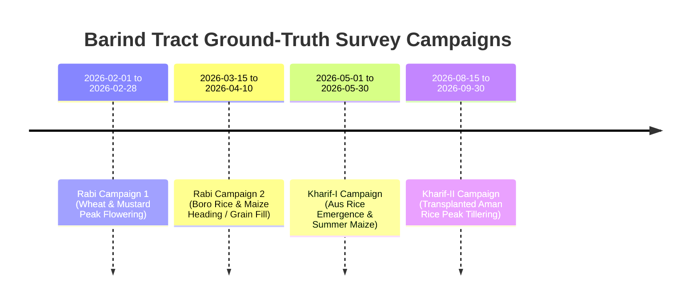

# Field Shift — Member 1 Satellite GIS: Crop Ground Truth Collection Plan
**NASA Space Apps Challenge 2026**  
**Project:** Field Shift — Adapting Farms with NASA Data (AgriSense Fusion)  
**Study Area:** Godagari Upazila, Rajshahi District, Bangladesh (High Barind Tract)  
**Author:** Senior Remote Sensing Scientist & Agricultural Survey Director  
**Date:** March 2026  

---

## 1. Executive Summary & Scientific Mandate

General land cover classification (Cropland, Tree Cover, Water, Built-Up) is operational and validated with 79.77% spatial block accuracy. However, **parcel-level crop species classification (differentiating Boro Rice vs. Winter Wheat vs. Hybrid Maize vs. Mustard)** remains **strictly BLOCKED**.

Global land cover proxies (such as ESA WorldCover 10m) provide only a single monolithic "Cropland" class (Value 40). Arbitrarily re-labeling satellite pixels as specific crop species without authentic ground truth constitutes data fabrication and produces fictitious scientific metrics.

This **Crop Ground Truth Collection Plan** establishes the rigorous field survey methodology, spatial stratification strategy, sample size quotas, mobile data collection toolchains, and quality assurance protocols required to unblock multi-crop classification in the Barind Tract.

---

## 2. Stratified Sampling Allocation Across Godagari Unions

Godagari Upazila spans $445.69\text{ km}^2$ divided into **8 administrative Unions** exhibiting diverse agro-ecological micro-environments:
- **Northern Barind High Terrace (Deopara, Gogram, Rishikul, Pakri):** Heavy Pleistocene red clay loam, deep groundwater table ($>25\text{ m}$), heavy reliance on BMDA deep tubewells; major Boro rice, wheat, and mustard cropping.
- **Central Alluvial Plain (Godagari, Matikata, Mohanpur):** Mixed loam, intensive triple-cropping, rapid expansion of hybrid maize and high-value vegetables.
- **Southern Riverine Chars (Char Ashariadaha):** Dynamic Padma river sandbars, sandy loam, seasonal flooding, zero deep tubewells; pulse, oilseed, and rainfed Aus rice cropping.

### Stratified Sample Allocation Matrix ($N=1,200$ Parcels):

| Union Name | Agro-Ecological Zone | Boro Rice | Winter Wheat | Hybrid Maize | Mustard / Oilseeds | Mango Orchards | Fallow / Other | Total Parcels |
|:---|:---|:---:|:---:|:---:|:---:|:---:|:---:|:---:|
| **1. Deopara** | High Barind Terrace | 60 | 45 | 35 | 20 | 15 | 10 | **185** |
| **2. Gogram** | High Barind Terrace | 55 | 40 | 35 | 20 | 15 | 10 | **175** |
| **3. Rishikul** | High Barind Terrace | 55 | 45 | 30 | 20 | 15 | 10 | **175** |
| **4. Pakri** | High Barind Terrace | 50 | 40 | 30 | 20 | 15 | 10 | **165** |
| **5. Godagari (Sadar)**| Central Semi-Urban | 40 | 35 | 30 | 15 | 10 | 10 | **140** |
| **6. Matikata** | Central Alluvial | 50 | 35 | 35 | 20 | 15 | 10 | **165** |
| **7. Mohanpur** | Central Alluvial | 50 | 35 | 35 | 15 | 10 | 10 | **155** |
| **8. Char Ashariadaha**| Riverine Chars / Sandbars| 40 | 25 | 20 | 20 | 5 | 10 | **120** |
| **Total Target** | **Godagari Upazila** | **400** | **300** | **250** | **150** | **100** | **80** | **1,280 Parcels** |

---

## 3. Parcel Geometry & GPS Collection Standards

### 3.1 Closed Polygon Mandate:
* **Isolated centroid points are strictly prohibited.** Centroid points risk capturing field bunds (*ails*), irrigation channels, or overhanging trees when intersected with 10m Sentinel-2 pixels.
* Every survey entry must record the **complete closed polygon boundary** of the agricultural plot.

### 3.2 Spatial Resolution & Buffer Rule:
* **Minimum Plot Size:** $> 0.1\text{ hectares}$ ($1,000\text{ m}^2$, encompassing at least $10$ pure Sentinel-2 $10\text{ m} \times 10\text{ m}$ pixels).
* **Negative 5-Meter Buffer:** During raster feature extraction, an internal negative 5m buffer is automatically applied to eliminate mixed boundary pixels:
  $$\text{Polygon}_{\text{pure}} = \text{ST\_Buffer}(\text{Polygon}_{\text{surveyed}}, -5.0)$$

### 3.3 GNSS Accuracy Requirement:
* Handheld smartphone GPS ($\pm 5\text{–}10\text{ m}$) is insufficient for parcel boundary delineation.
* Field enumerators must pair mobile tablets with an external **RTK GNSS receiver** (e.g. Emlid Reach RX or Bad Elf GNSS Surveyor) delivering sub-meter horizontal precision ($\le 0.5\text{ m}$).

---

## 4. Seasonal Survey Windows (Rabi & Kharif)

Ground-truth surveys must be conducted at the **phenological peak** of each crop when canopy cover is maximal ($>70\%$):

---

## 5. Field Survey Toolchain & Data Quality Protocol

### 5.1 Mobile Survey Tool:
* Standardized form deployed on **ODK Collect (OpenDataKit)** or **QField** running on Android tablets.
* Attributes aligned strictly with the data schema in [`data/labels/ground_truth_schema.md`](file:///F:/nasa%20project/data%20set%20that%20we%20test/Member_1_Satellite_GIS/data/labels/ground_truth_schema.md):
  - `plot_id` (Unique ID: `BD_RAJ_GOD_XXXXXX`)
  - `crop_species` (`Boro_Rice`, `Wheat`, `Maize`, `Mustard`, `Mango`, etc.)
  - `crop_variety` (e.g. `BRRI dhan29`, `BARI Gom-30`, `Pioneer 3355`)
  - `sowing_date` and `transplant_date`
  - `phenology_stage` (BBCH scale aligned)
  - `irrigation_source` (`BMDA_Deep_Tubewell`, `Shallow_Tubewell`, `Canal`, `Rainfed`)
  - `photos` (Geotagged photos facing North and South from plot centroid)

### 5.2 Multi-Tier Quality Control Workflow:
1. **Tier 1 (Automated In-App Checks):** Validation rules reject polygons with self-intersections, area $<500\text{ m}^2$, or vertices with GPS horizontal dilution of precision (HDOP) $>2.0$.
2. **Tier 2 (Supervisory Verification):** Upazila Agriculture Officer (DAE) reviews weekly GeoJSON batches against high-resolution PlanetScope / Sentinel-2 imagery to confirm field presence.
3. **Tier 3 (Scientific Split):** Cleaned data is partitioned into spatially disjoint training ($70\%$), validation ($15\%$), and untouched test ($15\%$) sets clustered by Mouza units to guarantee zero spatial leakage during crop-species ML training.
