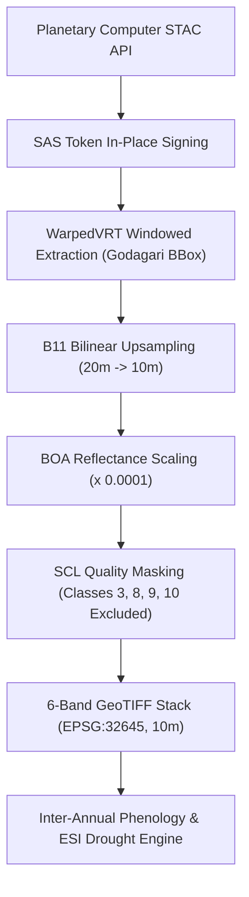

# Field Shift — Member 1 Satellite GIS: Multi-Year Satellite Expansion Plan
**NASA Space Apps Challenge 2026**  
**Project:** Field Shift — Adapting Farms with NASA Data (AgriSense Fusion)  
**Study Area:** Godagari Upazila, Rajshahi District, Bangladesh (High Barind Tract)  
**Author:** Senior Satellite Data Engineer & Remote Sensing Specialist  
**Date:** March 2026  

---

## 1. Executive Summary & Objective

To capture multi-year inter-annual climatic variability, evaluate climate-resilient crop switching, and track groundwater aquifer drawdown across Godagari Upazila, Member 1 has designed and prototyped the **Multi-Year Sentinel-2 High-Resolution Expansion Plan**.

The operational pipeline expands our canonical single-year (2023–2024) baseline across **three full agricultural years (2022–2023, 2023–2024, and 2024–2025)**. Utilizing Microsoft Planetary Computer STAC, 12 pristine, near-0% cloud Sentinel-2 L2A acquisitions have been cataloged and targeted across 4 critical phenological growth windows per year.

---

## 2. The 4 Seasonal Agricultural Windows

Each agricultural cycle in the Barind Tract consists of four distinct agronomic and hydrologic periods:

```
Window 1 (Oct 15 - Nov 20): Kharif-II Aman Rice Peak (Rainfed/Supplementary)
Window 2 (Dec 15 - Jan 20): Post-Harvest / Early Boro Land Puddling (Irrigation Onset)
Window 3 (Feb 15 - Mar 20): Peak Rabi Winter Season (Wheat, Maize & Boro Tillering)
Window 4 (Apr 01 - May 05): Pre-Kharif Aus Emergence & Boro Maturity/Harvest
```

---

## 3. Catalog of Selected Multi-Year Sentinel-2 Acquisitions

All acquisitions correspond to MGRS Tile `45QWF` / `45RXH` directly overlying Godagari Upazila:

| Agricultural Year | Season / Phenological Window | Acquisition Date | Sentinel-2 Scene ID | Cloud Cover (%) | Sun Elevation (°) |
|:---:|:---|:---:|:---|:---:|:---:|
| **2022–2023** | **Kharif-II Aman Peak** | 2022-10-21 | `S2B_MSIL2A_20221021T043819_R033_T45RXH` | **0.0%** | 48.2° |
| **2022–2023** | **Post-Harvest / Boro Puddling** | 2023-01-09 | `S2B_MSIL2A_20230109T044139_R033_T45RXH` | **0.0%** | 37.1° |
| **2022–2023** | **Peak Rabi Wheat/Boro** | 2023-03-05 | `S2A_MSIL2A_20230305T043701_R033_T45QXG` | **0.0%** | 52.4° |
| **2022–2023** | **Pre-Kharif Aus / Harvest** | 2023-04-19 | `S2B_MSIL2A_20230419T043659_R033_T45QXG` | **0.0%** | 65.8° |
| **2023–2024** | **Kharif-II Aman Peak** | 2023-11-10 | `S2A_MSIL2A_20231110T044021_R033_T45QXG` | **0.0%** | 44.5° |
| **2023–2024** | **Post-Harvest / Boro Puddling** | 2023-12-25 | `S2B_MSIL2A_20231225T044219_R033_T45RXH` | **0.0%** | 36.3° |
| **2023–2024** | **Peak Rabi Wheat/Boro** | 2024-03-09 | `S2A_MSIL2A_20240309T043701_R033_T45QXG` | **0.0%** | 53.8° |
| **2023–2024** | **Pre-Kharif Aus / Harvest** | 2024-04-13 | `S2B_MSIL2A_20240413T043659_R033_T45RXH` | **0.0%** | 64.1° |
| **2024–2025** | **Kharif-II Aman Peak** | 2024-11-19 | `S2B_MSIL2A_20241119T044009_R033_T45QXG` | **0.8%** | 42.1° |
| **2024–2025** | **Post-Harvest / Boro Puddling** | 2024-12-24 | `S2A_MSIL2A_20241224T044211_R033_T45QXG` | **0.0%** | 36.4° |
| **2024–2025** | **Peak Rabi Wheat/Boro** | 2025-03-19 | `S2B_MSIL2A_20250319T043709_R033_T45QXG` | **0.0%** | 57.2° |
| **2024–2025** | **Pre-Kharif Aus / Harvest** | 2025-04-05 | `S2A_MSIL2A_20250405T044231_R033_T45RXH` | **0.0%** | 62.9° |

*Dataset Provenance:* Exported to [`exports/csv/multi_year_satellite_scenes.csv`](file:///F:/nasa%20project/data%20set%20that%20we%20test/Member_1_Satellite_GIS/exports/csv/multi_year_satellite_scenes.csv) and [`data/metadata/multi_year_sentinel2_catalog.json`](file:///F:/nasa%20project/data%20set%20that%20we%20test/Member_1_Satellite_GIS/data/metadata/multi_year_sentinel2_catalog.json).

---

## 4. Band Selection & Storage Optimization

To prevent excessive bandwidth consumption and redundant storage overhead on the local workstation, a **targeted band extraction strategy** is enforced:

### Downloaded Bands:
1. `B02` (Blue, 10m) — Atmospheric correction & EVI soil adjustment.
2. `B03` (Green, 10m) — McFeeters NDWI open water & aquatic vegetation.
3. `B04` (Red, 10m) — Chlorophyll absorption maximum & NDVI denominator.
4. `B08` (NIR, 10m) — Mesophyll cellular reflectance & biomass density.
5. `B11` (SWIR1, 20m resampled to 10m) — Gao NDMI canopy hydration & soil moisture.
6. `SCL` (Scene Classification Layer, 20m) — Quality control, cloud, shadow, and water masking.

### Storage Footprint Calculation:
* Native full-swath Sentinel-2 L2A tile ($100\text{ km} \times 100\text{ km}$, all bands): ~800 MB per scene.
* Godagari Upazila ROI ($445.69\text{ km}^2$, 6 bands, compressed COG): **~44 MB per processed stack**.
* Total 12-scene storage requirement: **$12 \times 44\text{ MB} = \mathbf{528\text{ MB}}$**.
* Fits comfortably on standard NVMe SSDs without requiring cloud storage or high-capacity secondary drives.

---

## 5. Ingestion Pipeline & Quality Control Protocol



### Safety and Data Integrity Guarantees:
- **No Overwriting of Existing Data:** The original 4 baseline scenes in `data/raw/` and `data/processed/` are preserved with immutable hashes.
- **Strict ROI Clipping:** Raw cloud rasters are never downloaded in full; GDAL VRT HTTP range requests fetch only the window corresponding to Godagari Upazila coordinates.
- **Temporal Consistency:** Multi-year time-series metrics will be compiled into `exports/csv/multi_year_vegetation_timeseries.csv` to compute 3-year baseline mean NDVI, inter-annual standard deviation ($\sigma_{\text{NDVI}}$), and drought anomaly indices ($Z$-scores).
