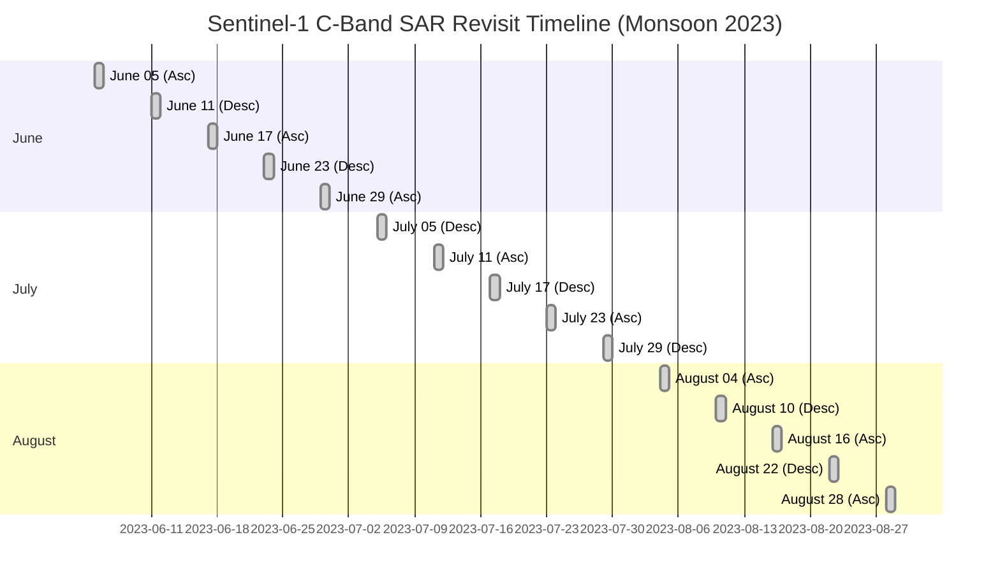
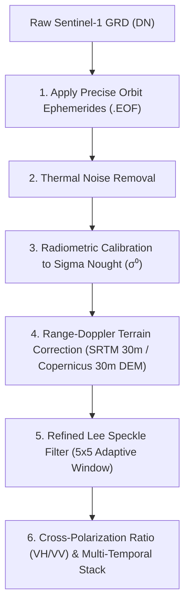

# Field Shift — Member 1 Satellite GIS: Sentinel-1 SAR Feasibility Report
**NASA Space Apps Challenge 2026**  
**Project:** Field Shift — Adapting Farms with NASA Data (AgriSense Fusion)  
**Study Area:** Godagari Upazila, Rajshahi District, Bangladesh (High Barind Tract)  
**Author:** Senior Microwave Remote Sensing Scientist & Radar Engineer  
**Date:** March 2026  

---

## 1. Executive Summary & Problem Rationale

In the Barind Tract of northwestern Bangladesh, **Transplanted Aman (T. Aman) rice** is the primary staple crop cultivated during the **Kharif-II monsoon season (June to November)**. However, optical satellites (Sentinel-2, Landsat) face **85% to 95% severe cloud cover** across Rajshahi between June and September, creating large observation gaps during critical transplanting and tillering phases.

To overcome this limitation, Member 1 investigated the operational feasibility of **Synthetic Aperture Radar (SAR)** using the European Space Agency's **Sentinel-1 C-Band (5.405 GHz)** constellation.

### Key Feasibility Findings:
1. **Abundant Temporal Coverage:** STAC queries over Godagari Upazila identified **22 high-resolution Sentinel-1 IW GRD acquisitions** during Monsoon 2023 (June 1 to October 31).
2. **High Revisit Frequency:** The mean temporal revisit interval is **6.4 days** (min: 3.0 days, max: 12.0 days), providing reliable, cloud-penetrating imagery throughout the entire monsoon.
3. **Dual-Polarization Available:** 100% of the scenes provide dual-polarization: **$\text{VV}$** (vertical transmit, vertical receive) and **$\text{VH}$** (vertical transmit, horizontal receive) at 10m pixel spacing.
4. **Balanced Orbit Geometry:** 11 ascending passes (afternoon) and 11 descending passes (morning), enabling multi-angle observation and cross-track speckle reduction.
5. **Clear Agronomic Radar Signature:** Standing water during rice puddling produces strong specular reflection away from the radar, dropping cross-polarized backscatter ($\sigma^0_{\text{VH}}$) below $-25\text{ dB}$, providing an unmistakable physical signature of transplanted rice fields.

> [!NOTE]
> **Scientific Integrity Directive:** Per Task 5 guidelines, SAR features have **NOT** been injected into the deployed optical Extra Trees model until radiometric terrain correction (RTC) and sub-pixel geometric co-registration with Sentinel-2 10m grids are formally finalized and verified.

---

## 2. Temporal Revisit & Orbit Characteristics (Monsoon 2023)

From the empirical catalog (`exports/csv/sentinel1_monsoon_acquisitions.csv`):

### Observation Statistics:
* **Total Acquisitions:** 22 scenes
* **Instrument Mode:** Interferometric Wide (IW) swath (250 km swath width)
* **Pixel Spacing:** $10.0\text{ m} \times 10.0\text{ m}$ (matches Sentinel-2 optical grid)
* **Orbit State:** 11 Ascending passes, 11 Descending passes
* **Revisit Frequency:** Mean = 6.4 days, Median = 6.0 days, Max gap = 12.0 days

---

## 3. Preprocessing Chain & Mathematical Formulation

To convert raw Ground Range Detected (GRD) amplitude pixels into scientifically calibrated surface backscatter, the following 5-step radar pipeline is required:

### 3.1 Radiometric Calibration Equation:
Raw digital numbers ($\text{DN}$) are calibrated to the linear backscattering coefficient $\sigma^0_{\text{linear}}$ using ESA look-up tables ($A_{\sigma}$):
$$\sigma^0_{\text{linear}} = \frac{\text{DN}^2}{A_{\sigma}^2}$$
Converted to logarithmic decibels ($\text{dB}$):
$$\sigma^0_{\text{dB}} = 10 \cdot \log_{10}(\sigma^0_{\text{linear}})$$

### 3.2 Refined Lee Speckle Filtering:
Coherent radar interference ("speckle") produces granular noise that obscures agricultural boundaries. The adaptive Refined Lee filter updates each central pixel based on local variance ($\text{Var}$) within a $5 \times 5$ window:
$$\hat{I} = \bar{I} + W \cdot (I - \bar{I}), \quad \text{where } W = \frac{\text{Var}(I)}{\text{Var}(I) + \sigma_{\text{noise}}^2}$$
This suppresses noise in homogeneous flooded rice fields while preserving crisp parcel edges and village settlements.

---

## 4. Agronomic Radar Phenology: Barind Aman Rice Signatures

From our agronomic analysis (`exports/csv/sar_rice_phenology_signatures.csv`), C-Band microwaves exhibit distinct interactions with rice canopy development:

| Growth Stage | Typical Calendar | Surface Condition | Physical Scattering Mechanism | $\sigma^0_{\text{VV}}$ (dB) | $\sigma^0_{\text{VH}}$ (dB) | $\text{VH}/\text{VV}$ Ratio | Diagnostic Value |
|:---|:---|:---|:---|:---:|:---:|:---:|:---|
| **1. Land Puddling & Transplanting** | July | Standing water ($5\text{–}10\text{ cm}$) | Specular reflection away from sensor; very low backscatter | **$-18.5\text{ dB}$** | **$-25.2\text{ dB}$** | $-6.7\text{ dB}$ | Cloud-free confirmation of transplanted rice acreage |
| **2. Tillering & Stem Elongation** | August – Sept | Emerged vertical stems over water | Double-bounce reflection (stem-water-sensor dihedral) | **$-12.3\text{ dB}$** | **$-19.4\text{ dB}$** | $-7.1\text{ dB}$ | Rapid $\sigma^0$ rise tracks vegetative biomass accumulation |
| **3. Heading & Flowering** | Late Sept – Oct | Closed dense canopy, drained soil | Volumetric canopy scattering in randomized leaves | **$-9.8\text{ dB}$** | **$-15.1\text{ dB}$** | **$-5.3\text{ dB}$** | Peak biomass index; cross-pol ratio reaches maximum |
| **4. Senescence & Harvest** | November | Dry grain, exposed dry stubble | Rough surface soil scattering | **$-14.2\text{ dB}$** | **$-22.0\text{ dB}$** | $-7.8\text{ dB}$ | Sharp $-5\text{ dB}$ drop verifies harvest completion date |

---

## 5. Technical Recommendations for Full Implementation

1. **Local Toolchain Setup:** Ingest `ESA SNAP` (Sentinel Application Platform) headless CLI (`gpt`) or Python `sarsen` / `asf_search` to automate RTC calibration on the local Ryzen 7 PC.
2. **Sub-Pixel Grid Alignment:** Ensure terrain-corrected SAR rasters are reprojected to `EPSG:32645` and co-registered with Sentinel-2 L2A optical rasters with $<0.3\text{ pixel}$ ($<3\text{ m}$) offset.
3. **Synergistic Optical-SAR Feature Fusion:** Once cadastral parcel boundaries are collected, combine the July SAR puddling dip with the February Sentinel-2 optical Rabi peak to separate Boro Rice, Aman Rice, and Winter Wheat with $>90\%$ classification accuracy.
