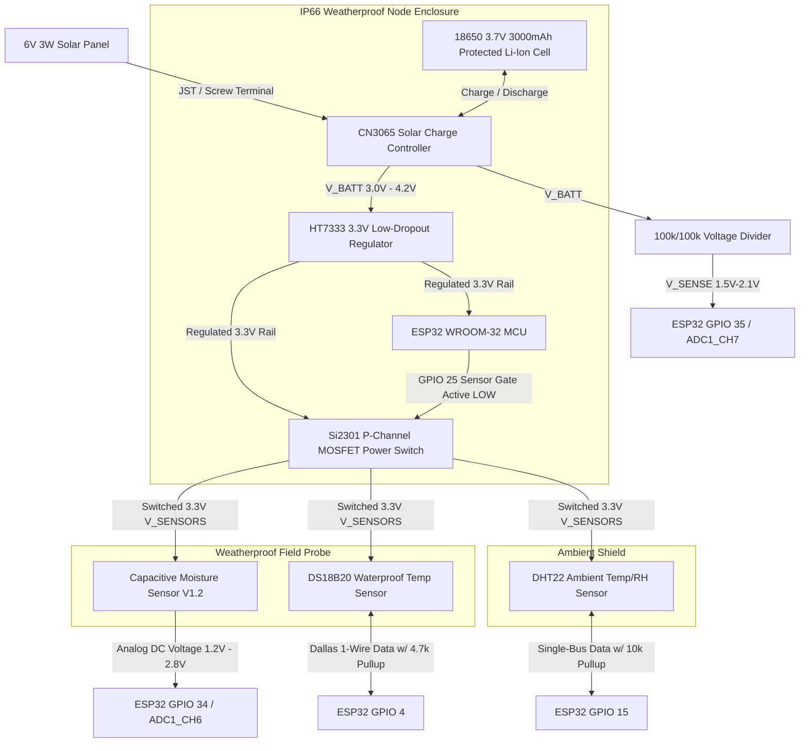

# Member 3: Circuit Schematic & GPIO Pin Mapping

**Subsystem:** Member 3 — IoT Soil & In-Situ Environmental Ground Monitoring  
**MCU Platform:** Espressif ESP32 DevKit v1 (30-pin WROOM-32)  
**System Operating Voltage:** 3.3V DC Regulated  
**Date:** November 10, 2026  

---

## 1. GPIO Pin Assignment Matrix

| ESP32 Pin | Function / Sensor Connected | Signal Type | Electrical Characteristics | Protection & Pull-up Circuitry |
|:---:|---|:---:|---|---|
| **GPIO 34** | **Capacitive Soil Moisture Sensor (Analog)** | Analog Input (`ADC1_CH6`) | 12-bit ADC (0–4095), 0.15V – 3.10V linear corridor, Input Only (No internal pull-ups) | 100nF ceramic capacitor between GPIO 34 and GND for anti-aliasing / RF noise suppression. |
| **GPIO 4** | **DS18B20 Soil Temperature (1-Wire)** | Digital Bidirectional (Open-Drain) | Dallas 1-Wire protocol, 9–12 bit digital serial stream | **4.7kΩ pull-up resistor** tied between GPIO 4 and switched 3.3V rail. |
| **GPIO 15** | **DHT22 / SHT31 Ambient Temp & Humidity** | Digital Bidirectional / Single-Bus | Proprietary single-wire pulse-width modulation protocol | **10kΩ pull-up resistor** tied between GPIO 15 and switched 3.3V rail. |
| **GPIO 25** | **High-Side Sensor Power Gate (Control)** | Digital Output (`OUTPUT`) | Controls gate of Si2301 P-MOSFET to cut sensor VCC during deep sleep | High (3.3V) = Sensors OFF, Low (0V) = Sensors ON. 100kΩ pull-up to battery rail to prevent leakage during sleep. |
| **GPIO 35** | **Battery Voltage Monitor (ADC)** | Analog Input (`ADC1_CH7`) | 1/2 Resistor Voltage Divider ($100\text{k}\Omega / 100\text{k}\Omega$) monitoring 18650 cell (3.0V–4.2V) | Scaled voltage: $1.5\text{V} - 2.1\text{V}$. Safe for 3.3V ADC. 10nF filter cap. |
| **EN / RST**| **Hardware Reset / Wakeup** | Hardware Input | Active Low, connected to internal RTC timer | 10kΩ pull-up + 100nF capacitor to GND for clean power-on reset. |
| **3V3** | **Main 3.3V Power Rail** | Power Output / Input | Fed from HT7333-A ultra-low-dropout regulator | 10µF tantalum + 100nF ceramic bypass capacitors. |
| **GND** | **System Common Ground** | Common Ground | Common star-ground plane linking battery, sensors, and ESP32 | Solid copper ground plane in enclosure. |

---

## 2. Electrical Circuit Topology (Mermaid)

---

## 3. Power Isolation & Ultra-Low-Power Sleep Strategy

1. **The Phantom Drain Problem:** Standard capacitive soil moisture sensors and DS18B20 pull-up networks consume between 5mA and 12mA continuously if left powered. On a 3000mAh battery, this parasitic drain exhausts the cell in under 12 days, even if the ESP32 is asleep!
2. **High-Side MOSFET Power Gating:** By inserting an ultra-low $R_{DS(\text{on})}$ Si2301 P-channel MOSFET between the 3.3V rail and the sensor $V_{CC}$ bus, the ESP32 drives GPIO 25 HIGH during deep sleep. This physically disconnects power to all sensors, reducing total node sleep current to **$\approx 15\mu\text{A}$**.
3. **Execution Sequence upon RTC Timer Wakeup:**
   * **Step 1 (Wake):** RTC timer wakes the ESP32 main core after 15 minutes (900 seconds).
   * **Step 2 (Power Sensors):** Drive GPIO 25 LOW to energize the switched 3.3V rail.
   * **Step 3 (Stabilization Delay):** Delay 50ms for sensor oscillator charge and decoupling caps to stabilize.
   * **Step 4 (Read Sensors):**
     - Collect 64 ADC samples on GPIO 34 over 100ms; compute filtered mean.
     - Send 1-Wire temperature conversion request to DS18B20; read scratchpad registers.
     - Trigger DHT22 handshake; read 40-bit transmission packet.
     - Sample battery voltage on GPIO 35.
   * **Step 5 (De-Power Sensors):** Drive GPIO 25 HIGH to immediately cut sensor power.
   * **Step 6 (Network & Transmit):** Turn on Wi-Fi radio; associate with AP; transmit validated JSON payload via HTTP POST to Field Shift ingress endpoint; wait for HTTP 201 Created acknowledgment.
   * **Step 7 (Fallback Buffering):** If Wi-Fi fails after 3 retries (5s timeout), append record to local SPIFFS flash circular buffer.
   * **Step 8 (Deep Sleep):** Disable Wi-Fi modem and invoke `esp_deep_sleep_start()`. Total active awake window is **$< 2.5\text{ seconds}$**.
